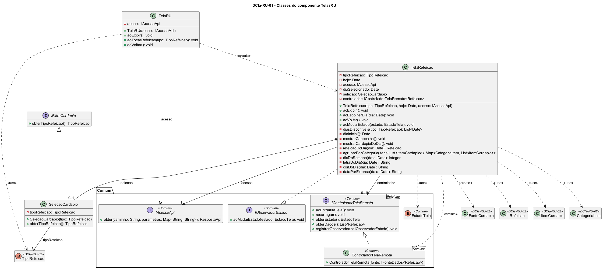

# DCla-RU-01 – Classes do componente TelasRU

| Campo | Valor |
|---|---|
| **Código** | `DCla-RU-01` |
| **Título** | Classes do componente TelasRU |
| **Autor(a)** | José Eduardo Gontijo de Carvalho (Pessoa C) |
| **Revisor(a)** | Phablo Tavares Paixão (Pessoa D) |
| **Status** | Em produção |
| **Rastreia para** | `DCmp-RU-01`, `DCla-RU-02`, `DCla-Comum-02`, `DCla-Comum-03`, `DIhc-RU-01`, `DIhc-RU-02`, `DSeq-RU-01`, `DSeq-RU-02`, `Contrato-RU-01` |

## Diagrama

Fonte: [`DCla-RU-01.puml`](DCla-RU-01.puml)

## Descrição

Classes do componente TelasRU. Cada método `ao...` das telas corresponde a um evento de interação dos protótipos.

- **TelaRU** é a tela de escolha da refeição (`DIhc-RU-01`): `aoExibir` (E0), `aoTocarRefeicao` (E1) e `aoVoltar` (E2). É estática (P-RU-2): não usa controlador e só guarda o acesso à API para repassá-lo à tela da refeição. `aoTocarRefeicao(tipo)` cria a `TelaRefeicao` com o tipo escolhido, a data de hoje e o acesso à API (`DSeq-RU-01`).
- **TelaRefeicao** é a tela do cardápio (`DIhc-RU-02`): `aoExibir` (E0, entrada e retorno), `aoEscolherDia` (E1) e `aoVoltar` (E2). Implementa `IObservadorEstado` (pacote Comum, `DCla-Comum-03`) e, em `aoMudarEstado`, mostra o cabeçalho e o cardápio do dia, a mensagem de vazio, a ilustração com "Cardápio indisponível." ou o indicador de carregamento. O construtor só guarda o tipo, a data de hoje e o acesso. **Na entrada** (primeira chamada de `aoExibir`), a tela cria a `SelecaoCardapio`, a `FonteCardapio` (`DCla-RU-02`) e o `ControladorTelaRemota<Refeicao>`, registra-se como observador, escolhe o `diaSelecionado` (`diaInicial`: hoje, ou a segunda-feira se hoje não está em `diasDisponiveis`: P-RU-13) e chama `aoEntrarNaTela`; **no retorno**, só chama `aoEntrarNaTela` de novo, e o dia escolhido é mantido. Como cada toque na tela RU cria uma `TelaRefeicao` nova, o dia volta a ser hoje a cada entrada.
  - **Semana em memória (P-RU-3):** a fonte traz a semana inteira da refeição numa só chamada, e o controlador guarda a lista. `aoEscolherDia(dia)` só muda o `diaSelecionado` e chama `mostrarCardapioDoDia`, que procura a `Refeicao` da data (`refeicaoDoDia`) em `controlador.obterDados()`: **não há `recarregar()` nem chamada ao servidor**, como na Rádio (`DCla-Radio-01`). A tela trata o vazio de um único dia; o controlador trata o vazio da semana inteira.
  - **`diasDisponiveis(tipo)`** devolve as datas que o seletor oferece, na semana que contém `hoje`: segunda a sábado (seis datas) no Café da Manhã e no Almoço, e segunda a sexta (cinco) no Jantar, que não tem sábado (P-RU-4). Não há letra para domingo.
  - **Apresentação:** `mostrarCabecalho` monta a barra e o fundo na cor do dia (`corDoDia`, P-RU-7), a data por extenso (`dataPorExtenso`, no formato "Terça-feira, 27 de outubro de 2026") e o seletor (`letraDoDia`, uma das letras S, T, Q, Q, S, S; `diaDaSemana` devolve 1 = segunda-feira a 7 = domingo). `agruparPorCategoria` agrupa os itens do dia, um cartão para cada categoria (P-RU-5).
- **IFiltroCardapio** é a interface que a `FonteCardapio` usa para ler a refeição escolhida (`DCla-RU-02`). Ela **não informa a data**: a data não vai à API (P-RU-3, P-RU-10).
- **SelecaoCardapio** implementa `IFiltroCardapio` e guarda só o tipo da refeição. Mantém-se como classe própria, no padrão dos filtros de outras telas (`IFiltroEventos`), para que a fonte dependa de uma interface e não da tela. O que só existia para reconsultar a API por dia (data selecionada, datas da semana) saiu do filtro: o dia selecionado e `diasDisponiveis` ficam na tela.

Decisão: a data da refeição é um `Date` (`DD-RU-01`), e não há enumeração própria de dia da semana no RU. A interface `IControladorTelaRemota` aparece com todas as operações atuais (`DCla-Comum-03`); a tela usa `aoEntrarNaTela`, `obterDados` e `registrarObservador`, e **não usa `recarregar`**. As interfaces e classes `<<Comum>>` pertencem ao pacote Comum e não são redefinidas aqui; `Refeicao`, `ItemCardapio`, `CategoriaItem` e `TipoRefeicao` são entidades do RU descritas em `DCla-RU-02`. Os contratos das operações estão em `Contrato-RU-01`.

As premissas `P-RU-n` citadas estão listadas, com o que as capturas de tela do app (versão 3.2.0) e o autor confirmaram e o que falta confirmar, em [`RU/README.md`](README.md).

## Referências

INSTITUTE OF ELECTRICAL AND ELECTRONICS ENGINEERS. **Guide to the Software Engineering Body of Knowledge – SWEBOK v4**. Cap. 3 (Software Design). IEEE, 2024.

ANTHROPIC. **Claude Code**. Assistente de IA. Disponível em: claude.ai/code. Acesso em: 30 out. 2026. Uso: apoio à redação e aos diagramas, a partir das instruções, das capturas de tela e das correções do autor (resumo em `IA/registro-C.md`). Questão: Apêndice <X>, Seção <X.1>.

---

## Registro de revisão

| Data | Revisor(a) | Situação | Observações |
|---|---|---|---|
| | | | |
