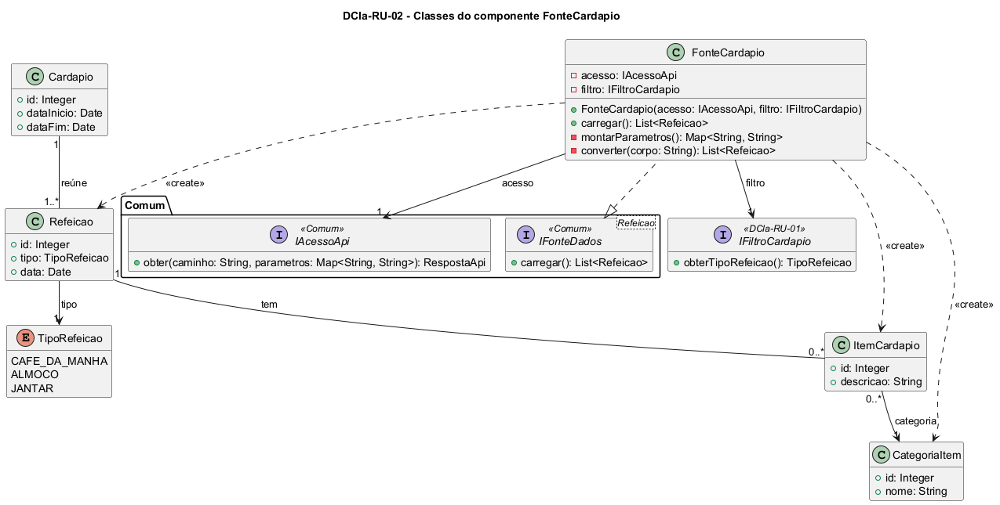

# DCla-RU-02 – Classes do componente FonteCardapio

| Campo | Valor |
|---|---|
| **Código** | `DCla-RU-02` |
| **Título** | Classes do componente FonteCardapio |
| **Autor(a)** | José Eduardo Gontijo de Carvalho (Pessoa C) |
| **Revisor(a)** | Phablo Tavares Paixão (Pessoa D) |
| **Status** | Em produção |
| **Rastreia para** | `DCmp-RU-01`, `DD-RU-01`, `DCla-RU-01`, `DCla-Comum-02`, `DCla-Comum-03`, `DSeq-RU-01`, `Contrato-RU-01` |

## Diagrama

Fonte: [`DCla-RU-02.puml`](DCla-RU-02.puml)

## Descrição

- **FonteCardapio:** implementa `IFonteDados<Refeicao>` (`DCla-Comum-03`). `carregar()` não tem parâmetros, como exige a interface do Comum; por isso a refeição vem do filtro (`IFiltroCardapio`, `DCla-RU-01`), lido a cada chamada. A fonte faz uma única chamada `IAcessoApi.obter("/cardapio", {refeicao})` (`DCla-Comum-02`), **sem data**, e recebe a semana inteira da refeição (P-RU-3, P-RU-10). `converter` monta uma `Refeicao` para cada data da resposta, cada uma com os seus `ItemCardapio` e a `CategoriaItem` de cada item. Não há cache: cada entrada na tela chama `carregar()` de novo, e trocar o dia na tela não chama (`DSeq-RU-02`). O `ErroApi` é repassado ao controlador, que o trata (`DEst-Comum-01`).
- **Por que `IFonteDados<Refeicao>`:** a resposta é uma lista de refeições, uma por data, e é essa a lista que o controlador do Comum guarda e a tela filtra em memória pela data (`Refeicao.data`), como a Rádio faz com o `HorarioPrograma` (que carrega o dia da semana). O controlador decide VAZIO pela lista inteira (semana sem refeições), e a tela trata o dia sem itens. A alternativa `IFonteDados<ItemCardapio>` foi descartada: o item não tem data, e a lista perderia a informação de qual dia cada item pertence. `Cardapio` também foi descartado como tipo da lista: a resposta traz a semana de uma só refeição, sem id nem período.
- **Cardapio, Refeicao, ItemCardapio, CategoriaItem** e a enumeração **TipoRefeicao** (CAFE_DA_MANHA, ALMOCO, JANTAR) são as entidades do RU, descritas no `DD-RU-01`. `Cardapio` é o agrupador da semana no servidor; **o app não o instancia**, pois a semana fica implícita nas datas das `Refeicao` recebidas (P-RU-10). Ele foi mantido no modelo de dados, e não removido, porque o cardápio é cadastrado por semana no painel web; a integração (D) pode retirá-lo sem afetar o app. A data da refeição é um `Date`; o dia da semana é derivado dela e não há enumeração própria (`DD-RU-01`). O Jantar não tem refeição em data que caia em sábado (P-RU-4).

A rota `/cardapio` e o parâmetro `refeicao` (valor de `TipoRefeicao`) são premissa de projeto, não observável no app (P-RU-10). As interfaces `<<Comum>>` pertencem ao pacote Comum e não são redefinidas aqui. Os contratos estão em `Contrato-RU-01`.

As premissas `P-RU-n` citadas estão listadas, com o que as capturas de tela do app (versão 3.2.0) e o autor confirmaram e o que falta confirmar, em [`RU/README.md`](README.md).

## Referências

INSTITUTE OF ELECTRICAL AND ELECTRONICS ENGINEERS. **Guide to the Software Engineering Body of Knowledge – SWEBOK v4**. Cap. 3 (Software Design). IEEE, 2024.

ANTHROPIC. **Claude Code**. Assistente de IA. Disponível em: claude.ai/code. Acesso em: 30 out. 2026. Uso: apoio à redação e aos diagramas, a partir das instruções, das capturas de tela e das correções do autor (resumo em `IA/registro-C.md`). Questão: Apêndice <X>, Seção <X.1>.

---

## Registro de revisão

| Data | Revisor(a) | Situação | Observações |
|---|---|---|---|
| | | | |
