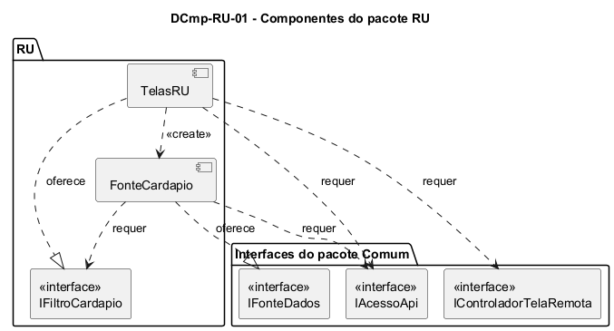

# DCmp-RU-01 – Componentes do pacote RU

| Campo | Valor |
|---|---|
| **Código** | `DCmp-RU-01` |
| **Título** | Componentes do pacote RU |
| **Autor(a)** | José Eduardo Gontijo de Carvalho (Pessoa C) |
| **Revisor(a)** | Phablo Tavares Paixão (Pessoa D) |
| **Status** | Em produção |
| **Rastreia para** | `DPac-Geral-01`, `DCmp-Comum-01`, `DCla-RU-01`, `DCla-RU-02`, `DSeq-RU-01` |

## Diagrama

Fonte: [`DCmp-RU-01.puml`](DCmp-RU-01.puml)

## Descrição

O pacote `RU` tem dois componentes. Eles dependem do pacote `Comum` apenas por interfaces, como pede o `DPac-Geral-01`, e não dependem de nenhum outro pacote de funcionalidade (o cardápio é único para todos os restaurantes: não há regional nem campus).

**Tabela 1 – Componentes do pacote RU**

| Componente | Responsabilidade | Interface oferecida | Interfaces requeridas (pacote Comum) | Classes |
|---|---|---|---|---|
| TelasRU | Exibe a tela RU (cartões das refeições) e a tela da refeição (data, cartões por categoria e seletor de dia); guarda o dia selecionado e filtra a semana em memória; trata os toques e a seta de voltar | `IFiltroCardapio` | `IControladorTelaRemota`, `IAcessoApi` (só para repassá-la à fonte) | `DCla-RU-01` |
| FonteCardapio | Busca na API, numa só chamada, as refeições da semana inteira da refeição escolhida e as converte em objetos `Refeicao`, cada um com os seus itens | `IFonteDados` (implementada para `Refeicao`) | `IAcessoApi`, `IFiltroCardapio` | `DCla-RU-02` |

**Como os componentes cooperam.** Ao tocar no cartão de uma refeição, a `TelaRU` cria a `TelaRefeicao`. Ao ser exibida pela primeira vez, esta cria o filtro (`SelecaoCardapio`), a `FonteCardapio` e o controlador de estados (`ControladorTelaRemota<Refeicao>`, pacote Comum), e entrega a fonte ao controlador (`DSeq-RU-01`). Por isso `TelasRU` depende de `FonteCardapio` apenas para criá-la; todo o resto do acesso é por interface. A `FonteCardapio` lê pela interface `IFiltroCardapio` só a refeição escolhida e traz a semana inteira (P-RU-3). Quando o usuário troca o dia, a tela **não** pede nova carga: ela filtra, em memória, os dados que o controlador já guarda (`obterDados()`), como a Rádio faz com a sua programação (`DSeq-RU-02`). Esse desenho segue o modelo de uso de `DCmp-Comum-01`.

**Decisão de projeto.** O filtro (`SelecaoCardapio`) guarda só a refeição, que é o que a fonte precisa saber; o dia selecionado é estado da tela e não chega à fonte. Assim, a fonte não conhece a interface gráfica e pode ser testada sozinha. A tela RU é estática e não usa o controlador (P-RU-2).

As premissas `P-RU-n` citadas estão listadas, com o que as capturas de tela do app (versão 3.2.0) e o autor confirmaram e o que falta confirmar, em [`RU/README.md`](README.md).

## Referências

INSTITUTE OF ELECTRICAL AND ELECTRONICS ENGINEERS. **Guide to the Software Engineering Body of Knowledge – SWEBOK v4**. Cap. 3 (Software Design). IEEE, 2024.

ANTHROPIC. **Claude Code**. Assistente de IA. Disponível em: claude.ai/code. Acesso em: 30 out. 2026. Uso: apoio à redação e aos diagramas, a partir das instruções, das capturas de tela e das correções do autor (resumo em `IA/registro-C.md`). Questão: Apêndice <X>, Seção <X.1>.

---

## Registro de revisão

| Data | Revisor(a) | Situação | Observações |
|---|---|---|---|
| | | | |
