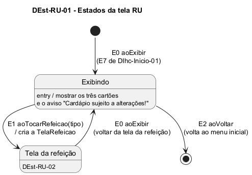

# DEst-RU-01 – Estados da tela RU

| Campo | Valor |
|---|---|
| **Código** | `DEst-RU-01` |
| **Título** | Estados da tela RU |
| **Autor(a)** | José Eduardo Gontijo de Carvalho (Pessoa C) |
| **Revisor(a)** | Phablo Tavares Paixão (Pessoa D) |
| **Status** | Em produção |
| **Rastreia para** | `DIhc-RU-01`, `DEst-RU-02`, `DEst-Inicio-01`, `DSeq-RU-01`, `DCla-RU-01`, `Contrato-RU-01` |

## Diagrama

Fonte: [`DEst-RU-01.puml`](DEst-RU-01.puml)

## Descrição

A tela RU é estática: não consulta o servidor (P-RU-2, não observável nas capturas), por isso **não usa** os estados de tela remota do Comum (`DEst-Comum-01`) e tem um só estado próprio, **Exibindo**, com os três cartões de refeição (P-RU-1; capturas 13 e 17, versão 3.2.0). Os eventos são os do `DIhc-RU-01`:

- **E0** (`aoExibir`): a tela é exibida, pela primeira vez (cartão RU do menu inicial, E7 de `DIhc-Inicio-01`) ou ao voltar da tela da refeição. Nos dois casos mostra os três cartões e o aviso, sem recarregar nada.
- **E1** (`aoTocarRefeicao`): cria a tela da refeição, que busca a semana inteira da refeição ao ser exibida; detalhada em `DEst-RU-02` (a sequência está em `DSeq-RU-01`).
- **E2** (`aoVoltar`): seta de voltar da barra de título; encerra a tela e volta ao menu inicial (P-RU-11; ver `DEst-Inicio-01`).

**Tabela 1 – Transições da tela RU**

| Origem | Evento | Destino |
|---|---|---|
| (início) | E0 `aoExibir` | Exibindo |
| Exibindo | E1 `aoTocarRefeicao(tipo)` | Tela da refeição (`DEst-RU-02`) |
| Tela da refeição | E0 `aoExibir` (voltar da tela da refeição) | Exibindo |
| Exibindo | E2 `aoVoltar` | (fim: menu inicial) |

As premissas `P-RU-n` citadas estão listadas, com o que as capturas de tela do app (versão 3.2.0) e o autor confirmaram e o que falta confirmar, em [`RU/README.md`](README.md).

## Referências

INSTITUTE OF ELECTRICAL AND ELECTRONICS ENGINEERS. **Guide to the Software Engineering Body of Knowledge – SWEBOK v4**. Cap. 11 (Software Engineering Models and Methods). IEEE, 2024.

ANTHROPIC. **Claude Code**. Assistente de IA. Disponível em: claude.ai/code. Acesso em: 30 out. 2026. Uso: apoio à redação e aos diagramas, a partir das instruções, das capturas de tela e das correções do autor (resumo em `IA/registro-C.md`). Questão: Apêndice <X>, Seção <X.1>.

---

## Registro de revisão

| Data | Revisor(a) | Situação | Observações |
|---|---|---|---|
| | | | |
