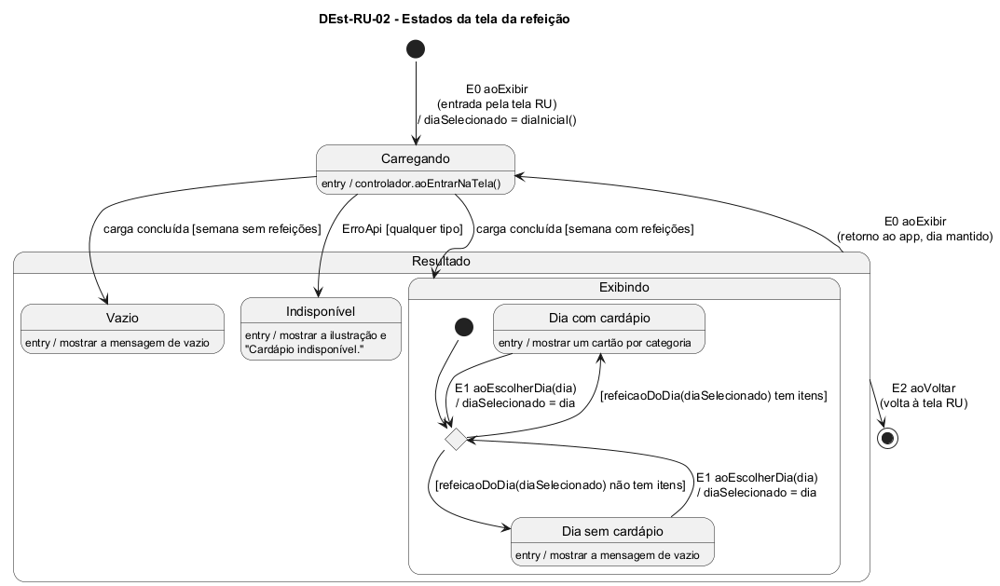

# DEst-RU-02 – Estados da tela da refeição

| Campo | Valor |
|---|---|
| **Código** | `DEst-RU-02` |
| **Título** | Estados da tela da refeição |
| **Autor(a)** | José Eduardo Gontijo de Carvalho (Pessoa C) |
| **Revisor(a)** | Phablo Tavares Paixão (Pessoa D) |
| **Status** | Em produção |
| **Rastreia para** | `DIhc-RU-02`, `DEst-RU-01`, `DEst-Comum-01`, `DCla-Comum-03`, `DSeq-RU-01`, `DSeq-RU-02`, `ECA-RU-01` |

## Diagrama

Fonte: [`DEst-RU-02.puml`](DEst-RU-02.puml)

## Descrição

Especializa o ciclo genérico de tela remota do Comum (`DEst-Comum-01`) para a tela da refeição, com os eventos do `DIhc-RU-02`, no mesmo desenho da Rádio (`DEst-Radio-01`). Os estados Exibindo, Vazio e Indisponível ficam reunidos no estado composto **Resultado**. A tela acrescenta:

- **E0** (`aoExibir`): na entrada pela tela RU, cria-se a seleção, a fonte e o controlador, o `diaSelecionado` é hoje (ou a segunda-feira, se hoje não tem letra no seletor: P-RU-13) e a tela vai a Carregando (`DSeq-RU-01`), que busca a semana inteira numa só chamada (P-RU-3). Ao voltar ao app depois de ficar em segundo plano, a tela é exibida de novo, o `diaSelecionado` é **mantido** (não volta a hoje) e a semana é buscada de novo, pois o app não guarda cache (`ECA-RU-01`, que especializa `ECA-CM-01`).
- **Exibindo** tem dois subestados, conforme o dia selecionado tem ou não itens em `refeicaoDoDia(diaSelecionado)`: "Dia com cardápio" (um cartão por categoria) e "Dia sem cardápio" (mensagem genérica de vazio, não observada: P-RU-9). **E1** (`aoEscolherDia`) troca o dia e reavalia a escolha, **sem sair de Exibindo, sem passar por Carregando e sem chamada à API** (`DSeq-RU-02`, P-RU-3). A cor da barra e do fundo e a data por extenso acompanham o dia (P-RU-7).
- **Vazio** (a semana inteira não tem refeições, decidido pelo controlador do Comum) e **Indisponível** (qualquer `ErroApi`) seguem o ciclo genérico. A Indisponível foi observada (captura 30, versão 3.2.0): ilustração de documentos, mensagem "Cardápio indisponível.", barra de título azul, sem data e sem seletor de dia (P-RU-8). Como o seletor só aparece em Exibindo, **E1 só ocorre nesse estado**; a aparência dos estados Carregando e Vazio não foi observada, e supõe-se a mesma da Indisponível (P-RU-9).
- **E2** (`aoVoltar`): seta de voltar da barra de título; a tela é encerrada e o estado (seleção, controlador, semana em memória e dia selecionado) é descartado, em qualquer estado de Resultado. O app volta à tela RU (P-RU-11), que é exibida de novo (`DEst-RU-01`, E0). Ao tocar de novo em uma refeição, uma tela nova é criada e o dia volta a ser hoje.

**Tabela 1 – Transições da tela da refeição**

| Origem | Evento | Condição | Destino |
|---|---|---|---|
| (início) | E0 `aoExibir` (entrada pela tela RU) | – | Carregando |
| Carregando | carga concluída | a semana tem refeições | Exibindo (Dia com cardápio ou Dia sem cardápio, conforme o dia selecionado) |
| Carregando | carga concluída | a semana não tem refeições | Vazio |
| Carregando | `ErroApi` | qualquer tipo | Indisponível |
| Exibindo | E1 `aoEscolherDia(dia)` | – | Exibindo (reavalia o dia; sem Carregando) |
| Resultado (Exibindo, Vazio ou Indisponível) | E0 `aoExibir` (retorno ao app) | – | Carregando |
| Resultado | E2 `aoVoltar` | – | (fim: tela RU) |

O Jantar não tem refeição aos sábados e o seletor dele não oferece o sábado (P-RU-4, confirmado na captura 26): não há, portanto, estado a modelar para essa data. Se hoje é domingo, ou sábado no Jantar, o dia inicial é a segunda-feira (P-RU-13).

As premissas `P-RU-n` citadas estão listadas, com o que as capturas de tela do app (versão 3.2.0) e o autor confirmaram e o que falta confirmar, em [`RU/README.md`](README.md).

## Referências

INSTITUTE OF ELECTRICAL AND ELECTRONICS ENGINEERS. **Guide to the Software Engineering Body of Knowledge – SWEBOK v4**. Cap. 11 (Software Engineering Models and Methods). IEEE, 2024.

ANTHROPIC. **Claude Code**. Assistente de IA. Disponível em: claude.ai/code. Acesso em: 30 out. 2026. Uso: apoio à redação e aos diagramas, a partir das instruções, das capturas de tela e das correções do autor (resumo em `IA/registro-C.md`). Questão: Apêndice <X>, Seção <X.1>.

---

## Registro de revisão

| Data | Revisor(a) | Situação | Observações |
|---|---|---|---|
| | | | |
