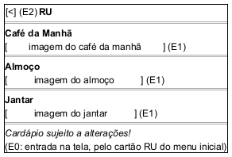

# DIhc-RU-01 – Protótipo da tela RU (escolha da refeição)

| Campo | Valor |
|---|---|
| **Código** | `DIhc-RU-01` |
| **Título** | Protótipo da tela RU (escolha da refeição) |
| **Autor(a)** | José Eduardo Gontijo de Carvalho (Pessoa C) |
| **Revisor(a)** | Phablo Tavares Paixão (Pessoa D) |
| **Status** | Em produção |
| **Rastreia para** | `DCdu-RU-01`, `DAtv-RU-01`, `DIhc-RU-02`, `DIhc-Inicio-01`, `DEst-RU-01`, `DSeq-RU-01` |

## Diagrama

Fonte: [`DIhc-RU-01.puml`](DIhc-RU-01.puml)

## Descrição

Protótipo da tela RU em PlantUML Salt, conforme as capturas 13 e 17 (versão 3.2.0): barra de título roxa com a seta de voltar e o título "RU", um cartão com imagem para cada refeição (Café da Manhã, Almoço e Jantar: P-RU-1) e o aviso "Cardápio sujeito a alterações!" no fim. A tela é estática: não consulta o servidor (P-RU-2). O desenho é em preto e branco; a cor da barra é só registrada aqui. Os rótulos `E0` a `E2` identificam os eventos de interação.

**Tabela 1 – Eventos de interação da tela**

| Rótulo | Elemento | Gesto | Efeito | Atividade |
|---|---|---|---|---|
| E0 | Tela (ao ser exibida) | Entrada pelo cartão RU do menu inicial (E7 do `DIhc-Inicio-01`) ou retorno da tela da refeição | Mostra os três cartões e o aviso; nenhuma chamada ao servidor | Passo interno de `DAtv-RU-01` |
| E1 | Cartão de uma refeição | Toque | Abre a tela da refeição escolhida (`DIhc-RU-02`), que carrega o cardápio da semana | `DAtv-RU-01`, A1 (`DSeq-RU-01`) |
| E2 | Seta de voltar na barra de título | Toque | Volta ao menu inicial (P-RU-11) | Navegação, sem atividade |

Os estados da tela estão em `DEst-RU-01`. As premissas `P-RU-n` citadas estão listadas, com o que as capturas de tela do app (versão 3.2.0) e o autor confirmaram e o que falta confirmar, em [`RU/README.md`](README.md).

## Referências

INSTITUTE OF ELECTRICAL AND ELECTRONICS ENGINEERS. **Guide to the Software Engineering Body of Knowledge – SWEBOK v4**. Cap. 11 (Software Engineering Models and Methods). IEEE, 2024.

ANTHROPIC. **Claude Code**. Assistente de IA. Disponível em: claude.ai/code. Acesso em: 30 out. 2026. Uso: apoio à redação e aos diagramas, a partir das instruções, das capturas de tela e das correções do autor (resumo em `IA/registro-C.md`). Questão: Apêndice <X>, Seção <X.1>.

---

## Registro de revisão

| Data | Revisor(a) | Situação | Observações |
|---|---|---|---|
| | | | |
