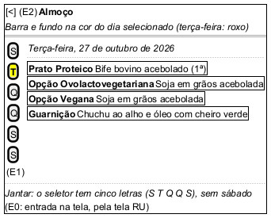

# DIhc-RU-02 – Protótipo da tela da refeição (cardápio do dia)

| Campo | Valor |
|---|---|
| **Código** | `DIhc-RU-02` |
| **Título** | Protótipo da tela da refeição (cardápio do dia) |
| **Autor(a)** | José Eduardo Gontijo de Carvalho (Pessoa C) |
| **Revisor(a)** | Phablo Tavares Paixão (Pessoa D) |
| **Status** | Em produção |
| **Rastreia para** | `DCdu-RU-01`, `DAtv-RU-01`, `DAtv-RU-02`, `DIhc-RU-01`, `DEst-RU-02`, `DSeq-RU-01`, `DSeq-RU-02`, `DEst-Comum-01` |

## Diagrama

Fonte: [`DIhc-RU-02.puml`](DIhc-RU-02.puml)

## Descrição

Protótipo da tela de uma refeição, no estado Exibindo. O exemplo é o Almoço de terça-feira, 27 de outubro de 2026 (captura 22, versão 3.2.0); as capturas 14 (Café da Manhã) e 22 a 27 (Almoço e Jantar) mostram a mesma estrutura: barra de título com a seta de voltar e o nome da refeição; a data por extenso; os itens em cartões por categoria; e, na borda esquerda, o **seletor de dia em coluna vertical**, com círculos de letras S, T, Q, Q, S, S (segunda a sábado), dos quais um fica destacado e deslocado para a direita (P-RU-4). No desenho, os círculos são botões e o destaque do dia escolhido é o fundo amarelo com negrito.

- **Cor do dia:** a barra de título e o fundo da tela têm a cor do dia selecionado: segunda-feira azul, terça roxo, quarta vermelho, quinta laranja, sexta verde e sábado marrom (P-RU-7; a segunda-feira só foi inferida pela cor da letra, P-RU-12). O desenho é em preto e branco e só registra a cor em texto.
- **Seletor de cinco letras no Jantar:** o Jantar não tem sábado, e o seletor tem só S, T, Q, Q, S (segunda a sexta; captura 26). Café da Manhã e Almoço têm as seis letras (P-RU-4). Só o Almoço está desenhado; a nota no fim do protótipo registra a variante do Jantar.
- **Categorias:** no Café da Manhã, "Leite", "Fruta", "Quitanda (vegana)" e "Pães e quitandas"; no Almoço e no Jantar, "Prato Proteico", "Opção Ovolactovegetariana", "Opção Vegana" e "Guarnição" (P-RU-5). Abaixo de "Guarnição" a captura é cortada, e outras categorias podem existir (P-RU-6). A descrição pode trazer um marcador, como "(1ª)" ou "(2ª)".
- **Estado indisponível (captura 30):** sem rede, a tela mostra barra de título **azul** com a seta de voltar e o nome da refeição, uma ilustração de documentos e a mensagem "Cardápio indisponível.", **sem data e sem seletor de dia** (P-RU-8). O fundo é branco. Como o seletor só aparece com o cardápio exibido, o evento E1 só ocorre no estado Exibindo (P-RU-9).
- **Estados carregando e vazio:** não foram observados. Supõe-se, como no estado indisponível, barra azul, sem data e sem seletor, com o indicador de carregamento ou a mensagem genérica de vazio do Comum (P-RU-9). Já o **dia sem itens** (a semana tem refeições, o dia não) mantém a cor do dia, a data e o seletor, e mostra a mesma mensagem de vazio no lugar dos cartões (P-RU-9).
- **Hoje fora do seletor:** o seletor não tem letra para domingo; quando hoje é domingo, ou sábado no Jantar, a tela seleciona a segunda-feira (P-RU-13).

Os rótulos `E0` a `E2` identificam os eventos de interação.

**Tabela 1 – Eventos de interação da tela**

| Rótulo | Elemento | Gesto | Efeito | Atividade |
|---|---|---|---|---|
| E0 | Tela (ao ser exibida) | Entrada pela tela RU (`DIhc-RU-01`, E1) ou retorno ao app | Na entrada, seleciona hoje (ou a segunda-feira: P-RU-13) e carrega o cardápio da semana (P-RU-3); no retorno, mantém o dia escolhido e recarrega a semana | `DAtv-RU-01`, A1 (`DSeq-RU-01`) |
| E1 | Letra do seletor de dia | Toque | Destaca o dia, muda a cor da barra e do fundo, atualiza a data por extenso e mostra o cardápio do dia a partir da semana em memória, sem chamada ao servidor (P-RU-3) | `DAtv-RU-02`, A1 (`DSeq-RU-02`) |
| E2 | Seta de voltar na barra de título | Toque | Volta à tela RU (P-RU-11); o estado da tela da refeição é descartado | Navegação, sem atividade |

Ao ser exibida, a tela sempre recarrega a semana, pois o app não guarda cache (`ECA-Comum-01`); trocar o dia, ao contrário, nunca recarrega. Os estados da tela estão em `DEst-RU-02`.

As premissas `P-RU-n` citadas estão listadas, com o que as capturas de tela do app (versão 3.2.0) e o autor confirmaram e o que falta confirmar, em [`RU/README.md`](README.md).

## Referências

INSTITUTE OF ELECTRICAL AND ELECTRONICS ENGINEERS. **Guide to the Software Engineering Body of Knowledge – SWEBOK v4**. Cap. 11 (Software Engineering Models and Methods). IEEE, 2024.

ANTHROPIC. **Claude Code**. Assistente de IA. Disponível em: claude.ai/code. Acesso em: 30 out. 2026. Uso: apoio à redação e aos diagramas, a partir das instruções, das capturas de tela e das correções do autor (resumo em `IA/registro-C.md`). Questão: Apêndice <X>, Seção <X.1>.

---

## Registro de revisão

| Data | Revisor(a) | Situação | Observações |
|---|---|---|---|
| | | | |
