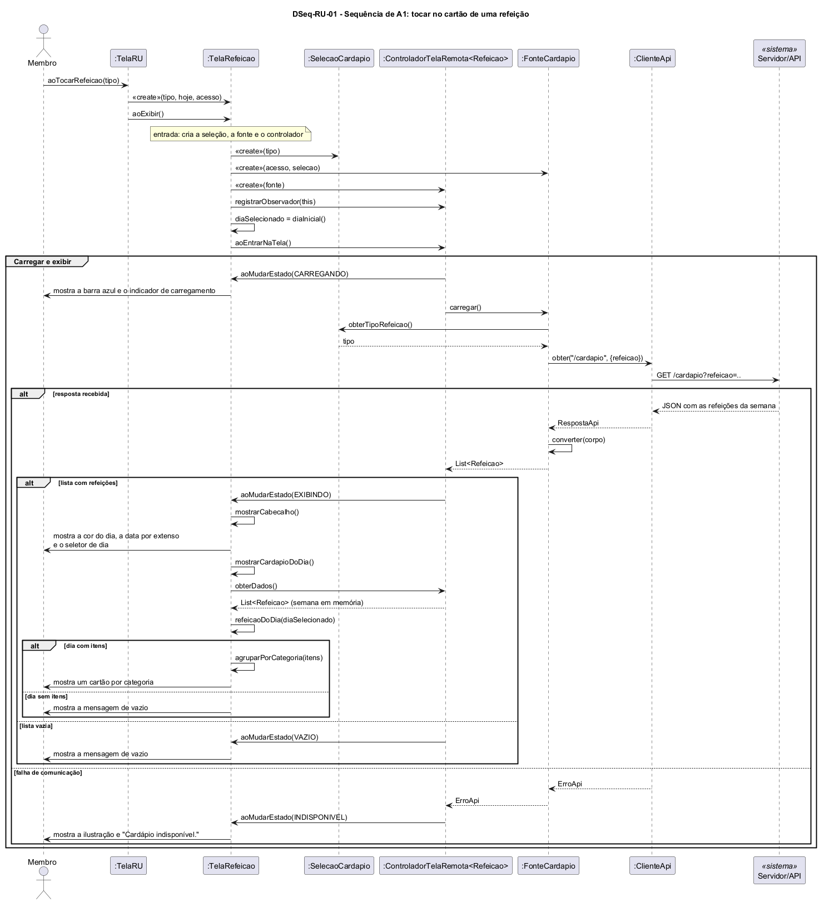

# DSeq-RU-01 – Sequência de A1: tocar no cartão de uma refeição

| Campo | Valor |
|---|---|
| **Código** | `DSeq-RU-01` |
| **Título** | Sequência de A1: tocar no cartão de uma refeição |
| **Autor(a)** | José Eduardo Gontijo de Carvalho (Pessoa C) |
| **Revisor(a)** | Phablo Tavares Paixão (Pessoa D) |
| **Status** | Em produção |
| **Rastreia para** | `DAtv-RU-01`, `DIhc-RU-01`, `DIhc-RU-02`, `DCla-RU-01`, `DCla-RU-02`, `DCla-Comum-02`, `DCla-Comum-03`, `DEst-Comum-01`, `Contrato-RU-01` |

## Diagrama

Fonte: [`DSeq-RU-01.puml`](DSeq-RU-01.puml)

## Descrição

Detalha a atividade A1 de `DAtv-RU-01`: o usuário toca no cartão de uma refeição na tela RU (evento E1 do `DIhc-RU-01`) e o app abre a tela da refeição com o cardápio da semana. A primeira mensagem é a operação `aoTocarRefeicao(tipo)` da `TelaRU` (`DCla-RU-01`).

1. A `TelaRU` cria a `TelaRefeicao`, passando o tipo da refeição, a data de hoje e o acesso à API, e chama `aoExibir()` nela (evento E0 do `DIhc-RU-02`).
2. Na **entrada** (primeira chamada de `aoExibir()` da tela), a `TelaRefeicao` cria a seleção (`SelecaoCardapio`, que só informa a refeição à fonte), a `FonteCardapio` e o controlador de estados do pacote Comum (`ControladorTelaRemota<Refeicao>`, `DCla-Comum-03`), registra-se como observador e escolhe o dia selecionado: hoje ou, se hoje não tem letra no seletor, a segunda-feira (`diaInicial()`, P-RU-13). Em seguida chama `aoEntrarNaTela()` no controlador. No retorno ao app, `aoExibir()` só chama `aoEntrarNaTela()` de novo, sem criar nada e sem alterar o dia (`ECA-RU-01`).
3. O fragmento **Carregar e exibir** é o ciclo genérico de `DEst-Comum-01`: o controlador pede os dados à `FonteCardapio`, que lê a refeição pela interface do filtro e consulta a API **uma só vez**, por meio de `IAcessoApi` (`DCla-Comum-02`), trazendo a semana inteira da refeição (P-RU-3). A resposta é convertida em uma `Refeicao` por data, cada uma com os seus itens.

Desfechos: lista com refeições leva a `EXIBINDO`, e a tela monta o cabeçalho (cor do dia, data por extenso e seletor) e mostra um cartão por categoria para o dia selecionado, lendo a semana em memória (`obterDados()`); se o dia não tem itens, mostra a mensagem de vazio (P-RU-9). Lista vazia leva a `VAZIO`. Qualquer `ErroApi` leva a `INDISPONIVEL`, em que a tela mostra a ilustração e "Cardápio indisponível.", com barra azul e sem data nem seletor (captura 30, versão 3.2.0: P-RU-8). O estado vazio não foi observado e segue o ciclo genérico do Comum (P-RU-9). A rota `/cardapio` e o parâmetro `refeicao`, sem data, são premissa de projeto (P-RU-10).

A seta de voltar não tem diagrama de sequência próprio: é modelada em `DIhc-RU-01`, `DIhc-RU-02`, `DEst-RU-01`, `DEst-RU-02` e `Contrato-RU-01`.

As premissas `P-RU-n` citadas estão listadas, com o que as capturas de tela do app (versão 3.2.0) e o autor confirmaram e o que falta confirmar, em [`RU/README.md`](README.md).

## Referências

INSTITUTE OF ELECTRICAL AND ELECTRONICS ENGINEERS. **Guide to the Software Engineering Body of Knowledge – SWEBOK v4**. Cap. 3 (Software Design). IEEE, 2024.

ANTHROPIC. **Claude Code**. Assistente de IA. Disponível em: claude.ai/code. Acesso em: 30 out. 2026. Uso: apoio à redação e aos diagramas, a partir das instruções, das capturas de tela e das correções do autor (resumo em `IA/registro-C.md`). Questão: Apêndice <X>, Seção <X.1>.

---

## Registro de revisão

| Data | Revisor(a) | Situação | Observações |
|---|---|---|---|
| | | | |
