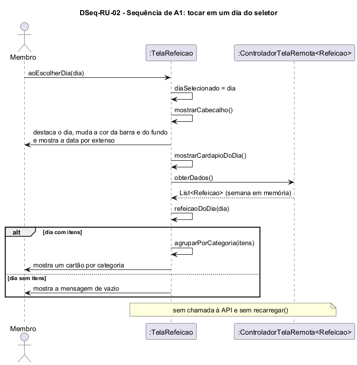

# DSeq-RU-02 – Sequência de A1: tocar em um dia do seletor

| Campo | Valor |
|---|---|
| **Código** | `DSeq-RU-02` |
| **Título** | Sequência de A1: tocar em um dia do seletor |
| **Autor(a)** | José Eduardo Gontijo de Carvalho (Pessoa C) |
| **Revisor(a)** | Phablo Tavares Paixão (Pessoa D) |
| **Status** | Em produção |
| **Rastreia para** | `DAtv-RU-02`, `DIhc-RU-02`, `DSeq-RU-01`, `DCla-RU-01`, `Contrato-RU-01`, `ECA-RU-01` |

## Diagrama

Fonte: [`DSeq-RU-02.puml`](DSeq-RU-02.puml)

## Descrição

Detalha a atividade A1 de `DAtv-RU-02` (evento E1 do `DIhc-RU-02`). A primeira mensagem é a operação `aoEscolherDia(dia)` da `TelaRefeicao` (`DCla-RU-01`), em que `dia` é uma das datas mostradas no seletor (`diasDisponiveis`: seis datas, de segunda a sábado, ou cinco, de segunda a sexta, no Jantar: P-RU-4).

A tela troca o `diaSelecionado`, redesenha o cabeçalho (destaque do dia, cor da barra e do fundo e data por extenso: P-RU-7) e mostra o cardápio do dia, lendo a semana que o controlador já tem em memória (`controlador.obterDados()`) e escolhendo a `Refeicao` da data (`refeicaoDoDia`). Se o dia tem itens, mostra um cartão por categoria; senão, a mensagem genérica de vazio, como a Rádio faz com um dia sem programas (`DSeq-Radio-02`; o caso não foi observado: P-RU-9). **Não há chamada à API, `recarregar()` nem estado de carregamento:** a carga da semana inteira foi feita na entrada na tela (`DSeq-RU-01`, P-RU-3), conforme informou o autor do projeto. As capturas 22 e 25 mostram o cardápio na tela com o ícone de modo avião, coerente com isso.

As premissas `P-RU-n` citadas estão listadas, com o que as capturas de tela do app (versão 3.2.0) e o autor confirmaram e o que falta confirmar, em [`RU/README.md`](README.md).

## Referências

INSTITUTE OF ELECTRICAL AND ELECTRONICS ENGINEERS. **Guide to the Software Engineering Body of Knowledge – SWEBOK v4**. Cap. 3 (Software Design). IEEE, 2024.

ANTHROPIC. **Claude Code**. Assistente de IA. Disponível em: claude.ai/code. Acesso em: 30 out. 2026. Uso: apoio à redação e aos diagramas, a partir das instruções, das capturas de tela e das correções do autor (resumo em `IA/registro-C.md`). Questão: Apêndice <X>, Seção <X.1>.

---

## Registro de revisão

| Data | Revisor(a) | Situação | Observações |
|---|---|---|---|
| | | | |
