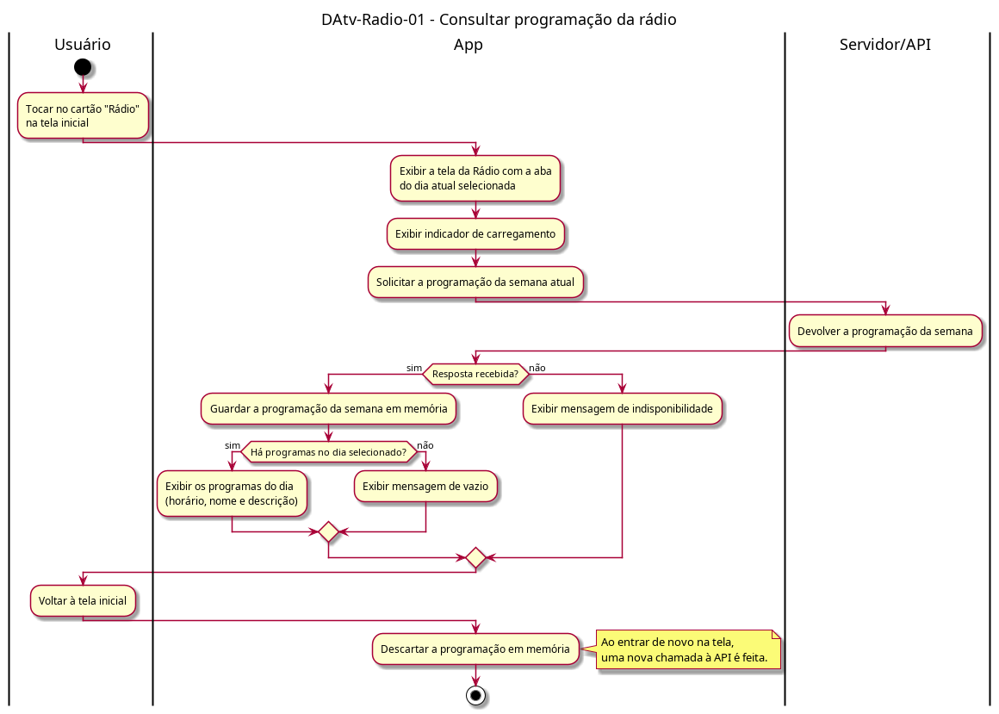

# DAtv-Radio-01 – Consultar programação da rádio

| Campo | Valor |
|---|---|
| **Código** | `DAtv-Radio-01` |
| **Título** | Consultar programação da rádio |
| **Autor(a)** | Pessoa D |
| **Revisor(a)** | Pessoa C |
| **Status** | Em produção |
| **Rastreia para** | `DCdu-Radio-01`, `DIhc-Radio-01`, `DEst-Comum-01` |

## Diagrama

Fonte: [`DAtv-Radio-01.puml`](DAtv-Radio-01.puml)

## Descrição

Atividades do UC02.1 do `DCdu-Radio-01`. A tela abre na aba do dia atual e carrega a programação da semana inteira numa só chamada ao Servidor/API. As saídas seguem os estados genéricos de tela remota do Comum (`DEst-Comum-01`): exibindo, vazio ou indisponível. A programação fica em memória só enquanto o usuário está na tela; ao voltar à tela inicial ela é descartada, e uma nova entrada faz nova chamada.

Ações que geram DSeq no D-IND-06: entrar na tela e carregar a programação (usuário → app → Servidor/API).

## Referências

ANTHROPIC. **Claude Code**. Assistente de IA. Disponível em: https://claude.com/claude-code. Acesso em: 20 out. 2026.

---

## Registro de revisão

| Data | Revisor(a) | Situação | Observações |
|---|---|---|---|
| | | | |
