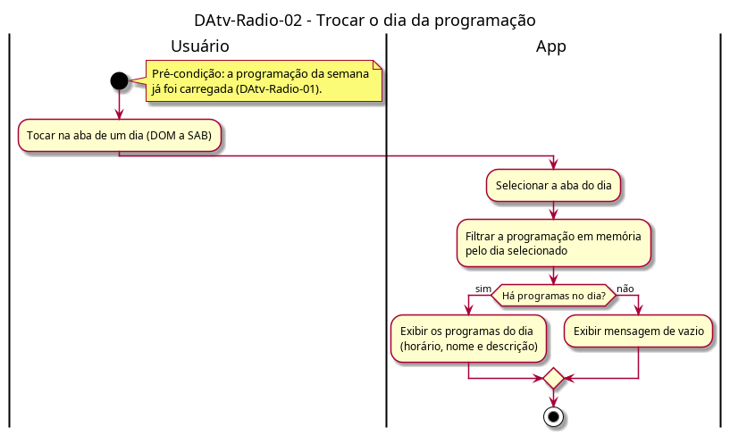

# DAtv-Radio-02 – Trocar o dia da programação

| Campo | Valor |
|---|---|
| **Código** | `DAtv-Radio-02` |
| **Título** | Trocar o dia da programação |
| **Autor(a)** | Pessoa D |
| **Revisor(a)** | Pessoa C |
| **Status** | Em produção |
| **Rastreia para** | `DCdu-Radio-01`, `DAtv-Radio-01`, `DIhc-Radio-01` |

## Diagrama

Fonte: [`DAtv-Radio-02.puml`](DAtv-Radio-02.puml)

## Descrição

Atividades do UC02.2 do `DCdu-Radio-01`. A troca de dia é feita só pelo toque na aba (evento E2 do `DIhc-Radio-01`). O app filtra a programação já em memória, sem chamada à API e sem estado de carregamento. Se o dia não tem programas, exibe a mensagem genérica de vazio.

Ação que gera DSeq no D-IND-06: tocar na aba de um dia (usuário → app).

## Referências

ANTHROPIC. **Claude Code**. Assistente de IA. Disponível em: https://claude.com/claude-code. Acesso em: 20 out. 2026.

---

## Registro de revisão

| Data | Revisor(a) | Situação | Observações |
|---|---|---|---|
| | | | |
