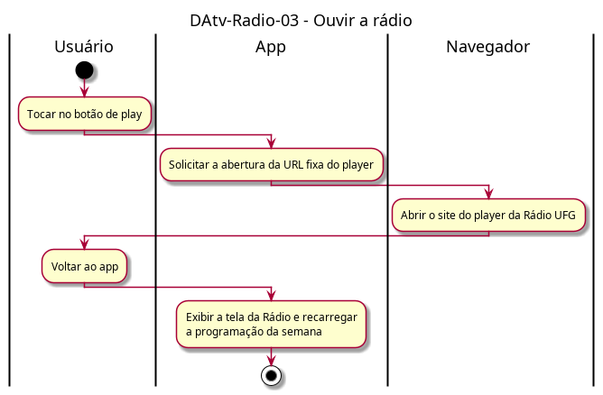

# DAtv-Radio-03 – Ouvir a rádio

| Campo | Valor |
|---|---|
| **Código** | `DAtv-Radio-03` |
| **Título** | Ouvir a rádio |
| **Autor(a)** | Pessoa D |
| **Revisor(a)** | Pessoa C |
| **Status** | Em produção |
| **Rastreia para** | `DCdu-Radio-01`, `DIhc-Radio-01`, `DCla-Comum-01`, `DAtv-Radio-01` |

## Diagrama

Fonte: [`DAtv-Radio-03.puml`](DAtv-Radio-03.puml)

## Descrição

Atividades do UC02.3 do `DCdu-Radio-01`. O botão de play (evento E3 do `DIhc-Radio-01`) abre uma URL fixa do player no navegador, por meio do componente LinkExterno do Comum (`ILinkExterno.abrirUrl`, `DCla-Comum-01`). A URL não tem parâmetros dinâmicos. A rádio não toca dentro do app.

Ao voltar do navegador, a tela da Rádio é exibida de novo e, pela regra global de recarga ao entrar na tela (`DEst-Comum-01`), a programação é carregada outra vez (`DAtv-Radio-01`).

Ação que gera DSeq no D-IND-06: tocar no play e abrir o player (usuário → app → navegador).

## Referências

ANTHROPIC. **Claude Code**. Assistente de IA. Disponível em: https://claude.com/claude-code. Acesso em: 20 out. 2026.

---

## Registro de revisão

| Data | Revisor(a) | Situação | Observações |
|---|---|---|---|
| | | | |
