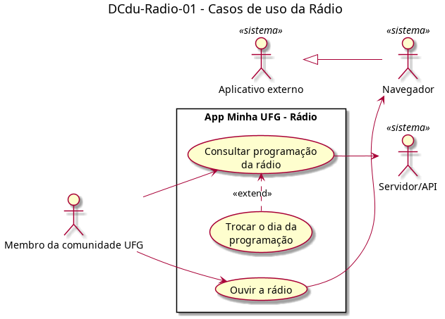

# DCdu-Radio-01 – Casos de uso da Rádio

| Campo | Valor |
|---|---|
| **Código** | `DCdu-Radio-01` |
| **Título** | Casos de uso da Rádio |
| **Autor(a)** | Pessoa D |
| **Revisor(a)** | Pessoa C |
| **Status** | Em produção |
| **Rastreia para** | `DCdu-Geral-01`, `DAtv-Radio-01`, `DAtv-Radio-02`, `DAtv-Radio-03`, `DIhc-Radio-01` |

## Diagrama

Fonte: [`DCdu-Radio-01.puml`](DCdu-Radio-01.puml)

## Descrição

Detalha o caso de uso UC02 "Consultar programação da rádio" do `DCdu-Geral-01` em três casos de uso. A tela mostra a programação da semana atual da Rádio UFG 88,5 FM, em abas de DOM a SAB, e um botão de play que abre o player num site externo (a rádio não toca dentro do app).

**UC02.1 – Consultar programação da rádio**

- **Atores:** Membro da comunidade UFG (principal, anônimo); Servidor/API.
- **Pré-condição:** o usuário está na tela inicial.
- **Fluxo principal:**
  1. O usuário toca no cartão "Rádio".
  2. O app abre a tela com a aba do dia atual selecionada e exibe o indicador de carregamento.
  3. O app solicita ao Servidor/API a programação da semana atual inteira, numa única chamada.
  4. O app guarda a programação em memória e exibe os programas do dia atual: horário (início e fim), nome e descrição.
- **Fluxo alternativo A1 (dia sem programas):** no passo 4, se o dia não tem programas, o app exibe a mensagem genérica de vazio.
- **Fluxo de exceção E1 (sem resposta):** no passo 3, se não há conexão ou o servidor falha, o app exibe a mensagem de indisponibilidade.
- **Pós-condição:** a programação da semana está em memória enquanto o usuário estiver na tela. Ao sair e entrar de novo, uma nova chamada é feita (sem cache).

**UC02.2 – Trocar o dia da programação** (estende UC02.1)

- **Ponto de extensão:** depois do passo 4 do UC02.1.
- **Fluxo principal:** o usuário toca na aba de um dia; o app filtra a programação em memória e exibe os programas daquele dia. Não há nova chamada à API. A troca é só por toque na aba; não há gesto de arrastar.
- **Fluxo alternativo A1:** dia sem programas → mensagem genérica de vazio.

**UC02.3 – Ouvir a rádio**

- **Atores:** Membro da comunidade UFG; Navegador.
- **Fluxo principal:** o usuário toca no botão de play; o app abre a URL fixa do player no navegador (`ILinkExterno.abrirUrl`, `DCla-Comum-01`), sem parâmetros. Ao voltar, o app exibe a tela da Rádio e recarrega a programação.

## Referências

ANTHROPIC. **Claude Code**. Assistente de IA. Disponível em: https://claude.com/claude-code. Acesso em: 20 out. 2026.

---

## Registro de revisão

| Data | Revisor(a) | Situação | Observações |
|---|---|---|---|
| | | | |
