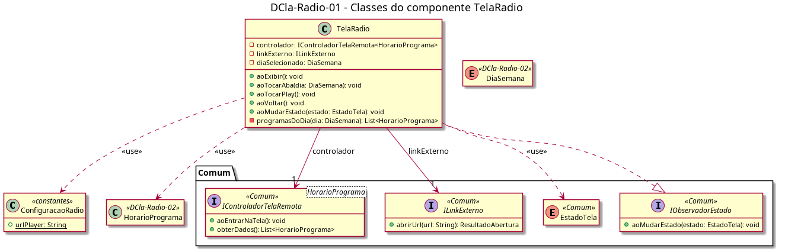

# DCla-Radio-01 – Classes do componente TelaRadio

| Campo | Valor |
|---|---|
| **Código** | `DCla-Radio-01` |
| **Título** | Classes do componente TelaRadio |
| **Autor(a)** | Pessoa D |
| **Revisor(a)** | Pessoa C |
| **Status** | Em produção |
| **Rastreia para** | `DCmp-Radio-01`, `DIhc-Radio-01`, `DCla-Radio-02`, `DCla-Comum-01`, `DCla-Comum-03` |

## Diagrama

Fonte: [`DCla-Radio-01.puml`](DCla-Radio-01.puml)

## Descrição

- **TelaRadio:** cada método `ao...` corresponde a um evento do `DIhc-Radio-01`: `aoExibir` (entrar ou voltar à tela), `aoVoltar` (E1), `aoTocarAba` (E2) e `aoTocarPlay` (E3). Implementa `IObservadorEstado` (`DCla-Comum-03`).
  - `diaSelecionado` começa no dia atual.
  - `aoTocarAba` só troca `diaSelecionado` e redesenha a lista com `programasDoDia`, que filtra os dados já carregados (`controlador.obterDados()`); não chama a API.
  - O controlador do Comum decide VAZIO pela semana inteira. O vazio de um único dia é tratado pela própria tela: em EXIBINDO, se `programasDoDia(diaSelecionado)` é vazio, ela mostra a mensagem genérica de vazio.
  - `aoTocarPlay` chama `linkExterno.abrirUrl(ConfiguracaoRadio.urlPlayer)`.
- **ConfiguracaoRadio:** constante `urlPlayer`, URL fixa do player, sem parâmetros.

As classes e interfaces `<<Comum>>` pertencem ao pacote Comum e não são redefinidas aqui.

## Referências

ANTHROPIC. **Claude Code**. Assistente de IA. Disponível em: https://claude.com/claude-code. Acesso em: 20 out. 2026.

---

## Registro de revisão

| Data | Revisor(a) | Situação | Observações |
|---|---|---|---|
| | | | |
