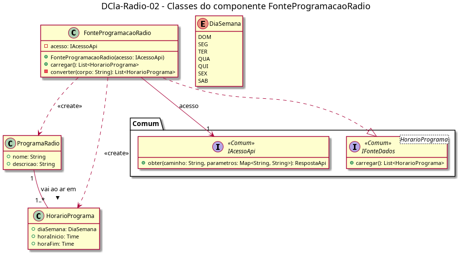

# DCla-Radio-02 – Classes do componente FonteProgramacaoRadio

| Campo | Valor |
|---|---|
| **Código** | `DCla-Radio-02` |
| **Título** | Classes do componente FonteProgramacaoRadio |
| **Autor(a)** | Pessoa D |
| **Revisor(a)** | Pessoa C |
| **Status** | Em produção |
| **Rastreia para** | `DCmp-Radio-01`, `DD-Radio-01`, `DCla-Comum-02`, `DCla-Comum-03`, `DCla-Radio-01` |

## Diagrama

Fonte: [`DCla-Radio-02.puml`](DCla-Radio-02.puml)

## Descrição

- **FonteProgramacaoRadio:** implementa `IFonteDados<HorarioPrograma>` (`DCla-Comum-03`). `carregar()` faz uma única chamada `IAcessoApi.obter` (`DCla-Comum-02`) para a programação da semana atual e `converter` monta os `ProgramaRadio` e os `HorarioPrograma`. Não há cache: cada entrada na tela chama `carregar()` de novo.
- **ProgramaRadio**, **HorarioPrograma** e **DiaSemana:** entidades da Rádio, descritas no `DD-Radio-01`.

O caminho exato do recurso na API não é conhecido (engenharia reversa); ele é definido no contrato da operação (D-IND-06) como premissa.

## Referências

ANTHROPIC. **Claude Code**. Assistente de IA. Disponível em: https://claude.com/claude-code. Acesso em: 20 out. 2026.

---

## Registro de revisão

| Data | Revisor(a) | Situação | Observações |
|---|---|---|---|
| | | | |
