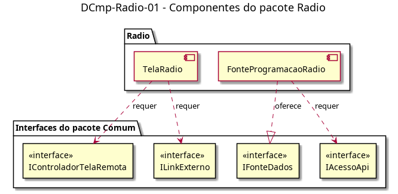

# DCmp-Radio-01 – Componentes do pacote Radio

| Campo | Valor |
|---|---|
| **Código** | `DCmp-Radio-01` |
| **Título** | Componentes do pacote Radio |
| **Autor(a)** | Pessoa D |
| **Revisor(a)** | Pessoa C |
| **Status** | Em produção |
| **Rastreia para** | `DPac-Geral-01`, `DCmp-Comum-01`, `DCla-Radio-01`, `DCla-Radio-02`, `DAtv-Radio-01` |

## Diagrama

Fonte: [`DCmp-Radio-01.puml`](DCmp-Radio-01.puml)

## Descrição

Dois componentes, no padrão dos demais pacotes com tela remota:

- **TelaRadio:** a tela com abas e botão de play. Requer `IControladorTelaRemota` (estados carregando, exibindo, vazio, indisponível e recarga ao entrar) e `ILinkExterno` (abrir o player no navegador).
- **FonteProgramacaoRadio:** oferece `IFonteDados` ao controlador do Comum e requer `IAcessoApi` para buscar a programação da semana.

Todas as interfaces são do pacote Comum (`DCmp-Comum-01`) e só são referenciadas aqui.

## Referências

ANTHROPIC. **Claude Code**. Assistente de IA. Disponível em: https://claude.com/claude-code. Acesso em: 20 out. 2026.

---

## Registro de revisão

| Data | Revisor(a) | Situação | Observações |
|---|---|---|---|
| | | | |
