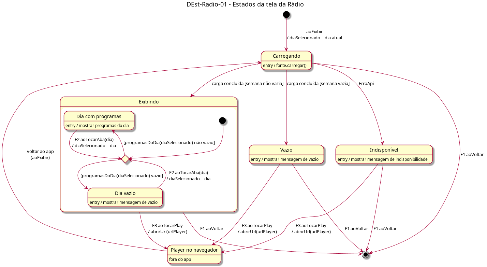

# DEst-Radio-01 – Estados da tela da Rádio

| Campo | Valor |
|---|---|
| **Código** | `DEst-Radio-01` |
| **Título** | Estados da tela da Rádio |
| **Autor(a)** | Pessoa D |
| **Revisor(a)** | Pessoa C |
| **Status** | Em produção |
| **Rastreia para** | `DIhc-Radio-01`, `DEst-Comum-01`, `DSeq-Radio-01`, `DSeq-Radio-02`, `DSeq-Radio-03`, `ECA-Radio-01` |

## Diagrama

Fonte: [`DEst-Radio-01.puml`](DEst-Radio-01.puml)

## Descrição

Especializa os estados genéricos de tela remota do Comum (`DEst-Comum-01`) para a Rádio, com os eventos do `DIhc-Radio-01`:

- **Carregando → Exibindo / Vazio / Indisponível:** resultado da carga semanal (`DSeq-Radio-01`).
- **Exibindo** tem dois subestados, conforme o dia selecionado tem ou não programas. E2 (tocar numa aba) troca o dia e reavalia a escolha, sem sair de Exibindo e sem recarregar (`DSeq-Radio-02`).
- **E3** (tocar no play) leva ao player no navegador; ao voltar, a tela recarrega (`DSeq-Radio-03`, `ECA-RA-01`).
- **E1** (voltar) encerra a tela; a programação em memória é descartada.

Premissa P-RA-2: o botão de play fica visível em Exibindo, Vazio e Indisponível, porque não depende dos dados carregados.

## Referências

ANTHROPIC. **Claude Code**. Assistente de IA. Disponível em: https://claude.com/claude-code. Acesso em: 20 out. 2026.

---

## Registro de revisão

| Data | Revisor(a) | Situação | Observações |
|---|---|---|---|
| | | | |
