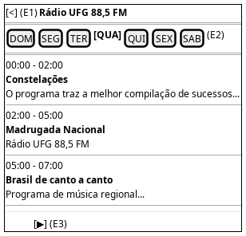

# DIhc-Radio-01 – Tela da Rádio

| Campo | Valor |
|---|---|
| **Código** | `DIhc-Radio-01` |
| **Título** | Tela da Rádio |
| **Autor(a)** | Pessoa D |
| **Revisor(a)** | Pessoa C |
| **Status** | Em produção |
| **Rastreia para** | `DCdu-Radio-01`, `DAtv-Radio-01`, `DAtv-Radio-02`, `DAtv-Radio-03`, `DEst-Radio-01` |

## Diagrama

Fonte: [`DIhc-Radio-01.puml`](DIhc-Radio-01.puml)

## Descrição

Protótipo da tela da Rádio, conforme o print da versão 3.1.1: barra com voltar e o título "Rádio UFG 88,5 FM", abas DOM a SAB com o dia atual selecionado (QUA, no exemplo), lista de programas do dia e botão flutuante de play. Cada item mostra o intervalo de horário, o nome do programa (em negrito) e a descrição.

| Evento | Origem | Efeito |
|---|---|---|
| E1 | Tocar em voltar | Volta à tela inicial; a programação em memória é descartada |
| E2 | Tocar na aba de um dia | Exibe os programas daquele dia, filtrados da programação em memória |
| E3 | Tocar no botão de play | Abre o player da rádio no navegador |

Os estados carregando, vazio e indisponível usam as mensagens genéricas do Comum (`DEst-Comum-01`) e são tratados no `DEst-Radio-01` (D-IND-06); não há protótipo separado para eles.

## Referências

ANTHROPIC. **Claude Code**. Assistente de IA. Disponível em: https://claude.com/claude-code. Acesso em: 20 out. 2026.

---

## Registro de revisão

| Data | Revisor(a) | Situação | Observações |
|---|---|---|---|
| | | | |
