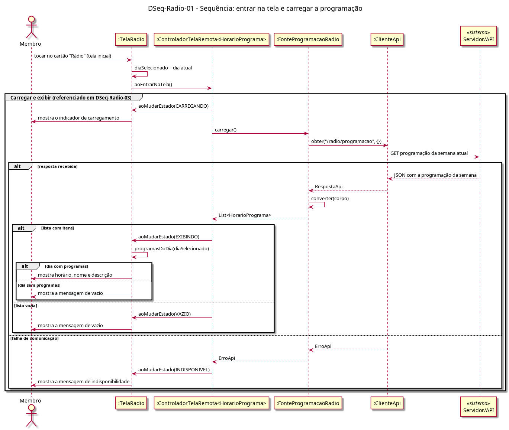

# DSeq-Radio-01 – Sequência: entrar na tela e carregar a programação

| Campo | Valor |
|---|---|
| **Código** | `DSeq-Radio-01` |
| **Título** | Sequência: entrar na tela e carregar a programação |
| **Autor(a)** | Pessoa D |
| **Revisor(a)** | Pessoa C |
| **Status** | Em produção |
| **Rastreia para** | `DAtv-Radio-01`, `DIhc-Radio-01`, `DCla-Radio-01`, `DCla-Radio-02`, `DCla-Comum-02`, `DCla-Comum-03`, `Contrato-Radio-01` |

## Diagrama

Fonte: [`DSeq-Radio-01.puml`](DSeq-Radio-01.puml)

## Descrição

Detalha a ação "entrar na tela e carregar a programação" do `DAtv-Radio-01`. A tela define o dia atual como selecionado e aciona o controlador genérico do Comum (`DCla-Comum-03`), que chama `FonteProgramacaoRadio.carregar()`. A fonte faz uma única chamada ao Servidor/API para a semana atual inteira (`DCla-Comum-02`).

Saídas: semana com itens → EXIBINDO, e a tela mostra os programas do dia ou, se o dia está vazio, a mensagem de vazio; semana vazia → VAZIO; falha de comunicação → INDISPONIVEL.

O caminho `/radio/programacao` é premissa (P-RA-1): o recurso real da API não é conhecido.

O fragmento "Carregar e exibir" é reutilizado no `DSeq-Radio-03`.

## Referências

ANTHROPIC. **Claude Code**. Assistente de IA. Disponível em: https://claude.com/claude-code. Acesso em: 20 out. 2026.

---

## Registro de revisão

| Data | Revisor(a) | Situação | Observações |
|---|---|---|---|
| | | | |
