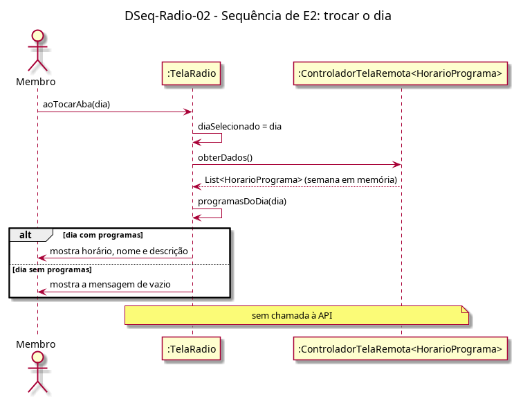

# DSeq-Radio-02 – Sequência de E2: trocar o dia

| Campo | Valor |
|---|---|
| **Código** | `DSeq-Radio-02` |
| **Título** | Sequência de E2: trocar o dia |
| **Autor(a)** | Pessoa D |
| **Revisor(a)** | Pessoa C |
| **Status** | Em produção |
| **Rastreia para** | `DAtv-Radio-02`, `DIhc-Radio-01`, `DCla-Radio-01`, `Contrato-Radio-01` |

## Diagrama

Fonte: [`DSeq-Radio-02.puml`](DSeq-Radio-02.puml)

## Descrição

Detalha a ação "tocar na aba de um dia" do `DAtv-Radio-02` (evento E2 do `DIhc-Radio-01`). A tela troca o dia selecionado e filtra a programação já em memória (`controlador.obterDados()`); não há chamada à API nem estado de carregamento. Dia sem programas mostra a mensagem genérica de vazio.

## Referências

ANTHROPIC. **Claude Code**. Assistente de IA. Disponível em: https://claude.com/claude-code. Acesso em: 20 out. 2026.

---

## Registro de revisão

| Data | Revisor(a) | Situação | Observações |
|---|---|---|---|
| | | | |
