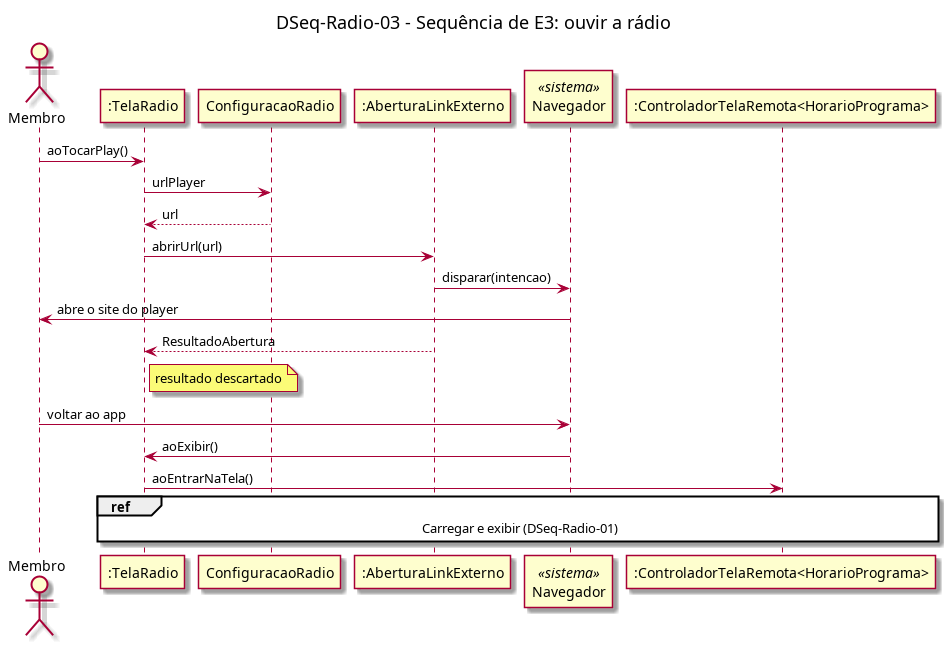

# DSeq-Radio-03 – Sequência de E3: ouvir a rádio

| Campo | Valor |
|---|---|
| **Código** | `DSeq-Radio-03` |
| **Título** | Sequência de E3: ouvir a rádio |
| **Autor(a)** | Pessoa D |
| **Revisor(a)** | Pessoa C |
| **Status** | Em produção |
| **Rastreia para** | `DAtv-Radio-03`, `DIhc-Radio-01`, `DCla-Radio-01`, `DCla-Comum-01`, `DSeq-Radio-01`, `ECA-Radio-01` |

## Diagrama

Fonte: [`DSeq-Radio-03.puml`](DSeq-Radio-03.puml)

## Descrição

Detalha a ação "tocar no play e abrir o player" do `DAtv-Radio-03` (evento E3 do `DIhc-Radio-01`). A tela lê a URL fixa de `ConfiguracaoRadio` e chama `ILinkExterno.abrirUrl` (`DCla-Comum-01`); o resultado é descartado. Ao voltar do navegador, a tela é exibida de novo e a programação é recarregada (`ECA-RA-01`), reutilizando o fragmento "Carregar e exibir" do `DSeq-Radio-01`.

## Referências

ANTHROPIC. **Claude Code**. Assistente de IA. Disponível em: https://claude.com/claude-code. Acesso em: 20 out. 2026.

---

## Registro de revisão

| Data | Revisor(a) | Situação | Observações |
|---|---|---|---|
| | | | |
