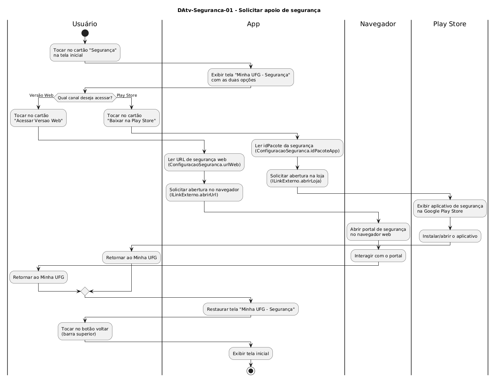

# DAtv-Seguranca-01 – Solicitar apoio de segurança

| Campo | Valor |
|---|---|
| **Código** | `DAtv-Seguranca-01` |
| **Título** | Solicitar apoio de segurança |
| **Autor(a)** | Maicon Brendo da Silva |
| **Revisor(a)** | Revisor(a) a definir |
| **Status** | Em produção |
| **Rastreia para** | `DCdu-Seguranca-01`, `DIhc-Seguranca-01`, `DCla-Comum-01`, `DSeq-Seguranca-01`, `DSeq-Seguranca-02` |

## Diagrama

Fonte: [`DAtv-Seguranca-01.puml`](DAtv-Seguranca-01.puml)

## Descrição

O diagrama modela o fluxo de atividades dos casos de uso `UC01` e `UC02` de `DCdu-Seguranca-01`, organizando as responsabilidades em quatro raias:
- **Usuário:** Interage com as opções em tela e com os aplicativos externos do dispositivo.
- **App:** Renderiza a tela de Segurança e delega a abertura externa para a interface `ILinkExterno` (`DCla-Comum-01`).
- **Navegador:** Aplicativo externo acionado para exibir a versão web da central de segurança.
- **Play Store:** Aplicativo da loja acionado para fornecer o download do aplicativo nativo de segurança.

### Ações de interação e granularidade de sequência

Em conformidade com a seção 6 do `contrato-base.md`, ações em que o usuário interage com o app disparando comunicação com o ambiente externo geram diagramas de sequência específicos:

| Ação no DAtv | Natureza da interação | Item gerado |
|---|---|---|
| Tocar em "Acessar Versao Web" | Usuário $\rightarrow$ App $\rightarrow$ `ILinkExterno.abrirUrl` $\rightarrow$ Navegador | `DSeq-Seguranca-01` |
| Tocar em "Baixar na Play Store (Android)" | Usuário $\rightarrow$ App $\rightarrow$ `ILinkExterno.abrirLoja` $\rightarrow$ Play Store | `DSeq-Seguranca-02` |

## Referências

GOOGLE. **Antigravity**. Assistente de IA para Engenharia de Software. Disponível em: https://antigravity.google.com. Acesso em: 29 out. 2026.

INSTITUTE OF ELECTRICAL AND ELECTRONICS ENGINEERS. **Guide to the Software Engineering Body of Knowledge – SWEBOK v4**. Cap. 11 (Software Engineering Models and Methods). IEEE, 2024.

---

## Registro de revisão

| Data | Revisor(a) | Situação | Observações |
|---|---|---|---|
| | | | |

