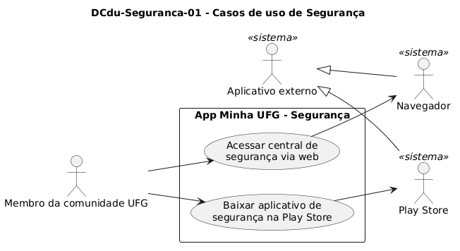

# DCdu-Seguranca-01 – Casos de uso de Segurança

| Campo | Valor |
|---|---|
| **Código** | `DCdu-Seguranca-01` |
| **Título** | Casos de uso de Segurança |
| **Autor(a)** | Maicon Brendo da Silva |
| **Revisor(a)** | Revisor(a) a definir |
| **Status** | Em produção |
| **Rastreia para** | `DCdu-Geral-01`, `DPac-Geral-01`, `DAtv-Seguranca-01`, `DIhc-Seguranca-01`, `DCla-Comum-01` |

## Diagrama

Fonte: [`DCdu-Seguranca-01.puml`](DCdu-Seguranca-01.puml)

## Descrição

O diagrama detalha o caso de uso macro UC01 "Solicitar apoio de segurança" do `DCdu-Geral-01`. A funcionalidade oferece à comunidade universitária dois canais institucionais diretos para acionamento do serviço de vigilância e segurança da UFG: acesso ao sistema web institucional ou instalação/abertura do aplicativo móvel oficial da segurança na Google Play Store.

### Atores

- **Membro da comunidade UFG:** Ator primário que utiliza a funcionalidade de forma anônima e sem exigência de autenticação prévia no app Minha UFG.
- **Navegador:** Ator secundário (especialização de Aplicativo externo) que assume a navegação ao portal web da segurança da UFG.
- **Play Store:** Ator secundário (especialização de Aplicativo externo) que gerencia o download e execução do aplicativo específico de segurança da UFG.

---

### UC01 – Acessar central de segurança via web

- **Ator principal:** Membro da comunidade UFG.
- **Ator secundário:** Navegador.
- **Pré-condição:** O usuário acessa a tela de Segurança a partir da tela inicial.
- **Fluxo principal:**
  1. O usuário toca no cartão "Acessar Versao Web".
  2. O app aciona o componente de integração externa (`ILinkExterno.abrirUrl`) informando a URL institucional da segurança (`https://seguranca.web.ufg.br`).
  3. O sistema operacional Android abre o navegador web padrão do dispositivo exibindo a página solicitada.
  4. O usuário interage com o portal externo e retorna ao Minha UFG quando desejar.
- **Pós-condição:** O navegador externo é iniciado com a URL da central de segurança e a tela de Segurança permanece intacta para retorno.

---

### UC02 – Baixar aplicativo de segurança na Play Store

- **Ator principal:** Membro da comunidade UFG.
- **Ator secundário:** Play Store.
- **Pré-condição:** O usuário acessa a tela de Segurança a partir da tela inicial.
- **Fluxo principal:**
  1. O usuário toca no cartão "Baixar na Play Store (Android)".
  2. O app aciona o componente de integração externa (`ILinkExterno.abrirLoja`) informando o pacote oficial (`br.ufg.cercomp.sistemaseguranca`).
  3. O sistema operacional Android abre o aplicativo da Google Play Store na página correspondente ao app de segurança.
  4. O usuário realiza a instalação ou abertura do app pela loja e retorna ao Minha UFG quando desejar.
- **Pós-condição:** A loja externa é acionada com o identificador de pacote fornecido.

## Referências

GOOGLE. **Antigravity**. Assistente de IA para Engenharia de Software. Disponível em: https://antigravity.google.com. Acesso em: 29 out. 2026.

INSTITUTE OF ELECTRICAL AND ELECTRONICS ENGINEERS. **Guide to the Software Engineering Body of Knowledge – SWEBOK v4**. Cap. 11 (Software Engineering Models and Methods). IEEE, 2024.

---

## Registro de revisão

| Data | Revisor(a) | Situação | Observações |
|---|---|---|---|
| | | | |

