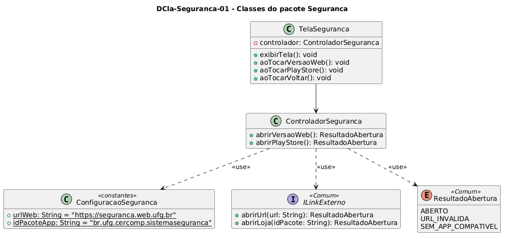

# DCla-Seguranca-01 – Classes do pacote Seguranca

| Campo | Valor |
|---|---|
| **Código** | `DCla-Seguranca-01` |
| **Título** | Classes do pacote Seguranca |
| **Autor(a)** | Maicon Brendo da Silva |
| **Revisor(a)** | Revisor(a) a definir |
| **Status** | Em produção |
| **Rastreia para** | `DPac-Geral-01`, `DCmp-Seguranca-01`, `DCla-Comum-01`, `DIhc-Seguranca-01`, `DSeq-Seguranca-01`, `DSeq-Seguranca-02` |

## Diagrama

Fonte: [`DCla-Seguranca-01.puml`](DCla-Seguranca-01.puml)

## Descrição

O diagrama detalha a estrutura orientada a objetos do pacote `Seguranca`, compreendendo a camada de visualização (`TelaSeguranca`), a camada de controle (`ControladorSeguranca`) e a configuração local imutável (`ConfiguracaoSeguranca`).

### Decisões de modelagem e arquitetura

1. **Ausência de modelo de dados próprio:** Conforme registrado na tabela de pesos e no `contrato-base.md`, a funcionalidade de Segurança não armazena dados persistentes locais e não consome endpoints dinâmicos de dados da API. Suas referências institucionais são constantes estáticas declaradas em `ConfiguracaoSeguranca`.
2. **Reutilização da interface ILinkExterno:** A camada de controle interage exclusivamente com a interface padronizada `ILinkExterno` do pacote `Comum` (`DCla-Comum-01`):
   - `abrirVersaoWeb()` utiliza o método `abrirUrl(urlWeb)`.
   - `abrirPlayStore()` utiliza o método `abrirLoja(idPacoteApp)`.
3. **Isolamento de plataforma:** O pacote `Seguranca` permanece totalmente independente de APIs nativas do Android, transferindo a instanciação e disparo de Intents para o componente `AberturaLinkExterno`.

## Referências

GOOGLE. **Antigravity**. Assistente de IA para Engenharia de Software. Disponível em: https://antigravity.google.com. Acesso em: 29 out. 2026.

INSTITUTE OF ELECTRICAL AND ELECTRONICS ENGINEERS. **Guide to the Software Engineering Body of Knowledge – SWEBOK v4**. Cap. 3 (Software Design). IEEE, 2024.

---

## Registro de revisão

| Data | Revisor(a) | Situação | Observações |
|---|---|---|---|
| | | | |

