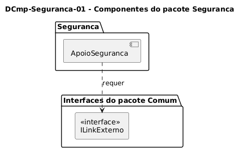

# DCmp-Seguranca-01 – Componentes do pacote Seguranca

| Campo | Valor |
|---|---|
| **Código** | `DCmp-Seguranca-01` |
| **Título** | Componentes do pacote Seguranca |
| **Autor(a)** | Maicon Brendo da Silva |
| **Revisor(a)** | Revisor(a) a definir |
| **Status** | Em produção |
| **Rastreia para** | `DPac-Geral-01`, `DImp-Geral-01`, `DCmp-Comum-01`, `DCla-Seguranca-01` |

## Diagrama

Fonte: [`DCmp-Seguranca-01.puml`](DCmp-Seguranca-01.puml)

## Descrição

O diagrama ilustra os componentes de software do módulo `Seguranca` e seu acoplamento com os serviços compartilhados da aplicação.

### Estrutura de Componentes

- **`ApoioSeguranca`:** Componente responsável por gerenciar a navegação e a apresentação dos canais de atendimento e apoio da segurança institucional.
- **`ILinkExterno`:** Interface requerida pertencente ao componente `LinkExterno` do pacote `Comum` (`DCmp-Comum-01`).

Essa divisão garante que o componente `ApoioSeguranca` concentre apenas a lógica de apresentação e redirecionamento, delegando a responsabilidade de comunicação com a plataforma hospedeira ao pacote `Comum`.

## Referências

GOOGLE. **Antigravity**. Assistente de IA para Engenharia de Software. Disponível em: https://antigravity.google.com. Acesso em: 29 out. 2026.

INSTITUTE OF ELECTRICAL AND ELECTRONICS ENGINEERS. **Guide to the Software Engineering Body of Knowledge – SWEBOK v4**. Cap. 3 (Software Design). IEEE, 2024.

---

## Registro de revisão

| Data | Revisor(a) | Situação | Observações |
|---|---|---|---|
| | | | |

