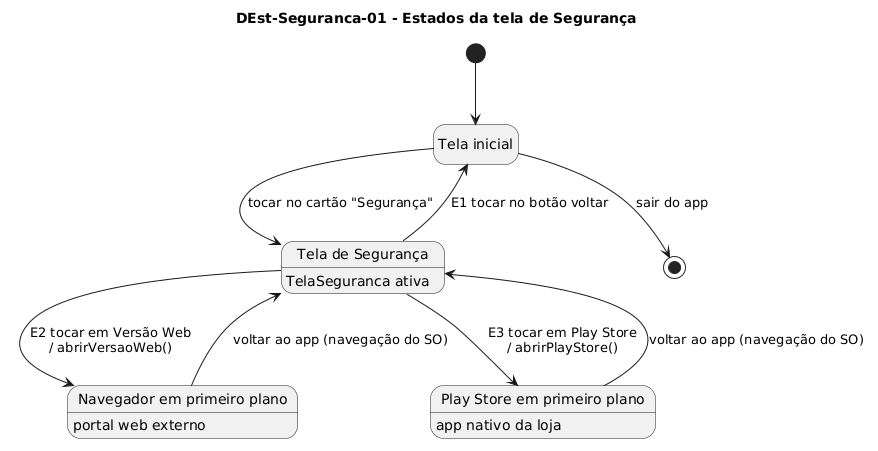

# DEst-Seguranca-01 – Estados da tela de Segurança

| Campo | Valor |
|---|---|
| **Código** | `DEst-Seguranca-01` |
| **Título** | Estados da tela de Segurança |
| **Autor(a)** | Maicon Brendo da Silva |
| **Revisor(a)** | Revisor(a) a definir |
| **Status** | Em produção |
| **Rastreia para** | `DCdu-Seguranca-01`, `DIhc-Seguranca-01`, `DIhc-Inicio-01`, `DSeq-Seguranca-01`, `DSeq-Seguranca-02` |

## Diagrama

Fonte: [`DEst-Seguranca-01.puml`](DEst-Seguranca-01.puml)

## Descrição

O diagrama de transição de estados modela os estados da interface de usuário da funcionalidade Segurança e suas transições para os sistemas externos e para a tela inicial.

### Estados

- **Tela inicial:** Ponto de entrada padrão do aplicativo Minha UFG.
- **Tela de Segurança:** Estado ativo da interface `TelaSeguranca`, com os dois cartões de seleção exibidos.
- **Navegador em primeiro plano:** Estado em que o navegador web padrão do dispositivo assume o controle visual, exibindo o portal web da segurança da UFG.
- **Play Store em primeiro plano:** Estado em que o aplicativo oficial da Google Play Store assume o controle visual, exibindo a página do app móvel da segurança.

### Transições de interface

| Transição | Evento | Condição / Guarda | Ação disparada |
|---|---|---|---|
| Entrada em Segurança | Toque no cartão "Segurança" na tela inicial | – | Transiciona para a `TelaSeguranca` |
| Acesso Web | Evento `E2` | Toque no cartão "Acessar Versao Web" | Dispara `abrirVersaoWeb()` e transfere foco ao navegador |
| Acesso Play Store | Evento `E3` | Toque no cartão "Baixar na Play Store (Android)" | Dispara `abrirPlayStore()` e transfere foco à loja |
| Retorno de Web ou Loja | Botão voltar do sistema operacional | – | Retoma o foco na `TelaSeguranca` |
| Retorno à tela inicial | Evento `E1` (botão voltar na barra superior) | – | Restaura a tela inicial |

## Referências

GOOGLE. **Antigravity**. Assistente de IA para Engenharia de Software. Disponível em: https://antigravity.google.com. Acesso em: 29 out. 2026.

INSTITUTE OF ELECTRICAL AND ELECTRONICS ENGINEERS. **Guide to the Software Engineering Body of Knowledge – SWEBOK v4**. Cap. 11 (Software Engineering Models and Methods). IEEE, 2024.

---

## Registro de revisão

| Data | Revisor(a) | Situação | Observações |
|---|---|---|---|
| | | | |

