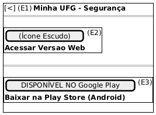

# DIhc-Seguranca-01 – Interface da tela de Segurança

| Campo | Valor |
|---|---|
| **Código** | `DIhc-Seguranca-01` |
| **Título** | Interface da tela de Segurança |
| **Autor(a)** | Maicon Brendo da Silva |
| **Revisor(a)** | Revisor(a) a definir |
| **Status** | Em produção |
| **Rastreia para** | `DCdu-Seguranca-01`, `DAtv-Seguranca-01`, `DEst-Seguranca-01`, `DSeq-Seguranca-01`, `DSeq-Seguranca-02` |

## Diagrama

Fonte: [`DIhc-Seguranca-01.puml`](DIhc-Seguranca-01.puml)

## Descrição

O protótipo de IHC (Interface Homem-Computador) representa fielmente a tela "Minha UFG - Segurança" da versão 3.1.1 do app, obtida por engenharia reversa das capturas de tela reais.

A interface possui fundo com gradiente azul, barra de topo azul com botão voltar e dois cartões retangulares brancos centrais:
1. Cartão com ícone de escudo azul e texto "Acessar Versao Web".
2. Cartão com selo oficial "DISPONÍVEL NO Google Play" e texto "Baixar na Play Store (Android)".

### Mapeamento de eventos de interação

| Evento | Elemento disparador | Origem | Ação / Efeito no app |
|---|---|---|---|
| **E1** | Botão voltar `[<]` na barra de topo | Usuário $\rightarrow$ App | Retorna para a tela inicial do Minha UFG |
| **E2** | Cartão "Acessar Versao Web" | Usuário $\rightarrow$ App | Dispara `ILinkExterno.abrirUrl("https://seguranca.web.ufg.br")` |
| **E3** | Cartão "Baixar na Play Store (Android)" | Usuário $\rightarrow$ App | Dispara `ILinkExterno.abrirLoja("br.ufg.cercomp.sistemaseguranca")` |

## Referências

GOOGLE. **Antigravity**. Assistente de IA para Engenharia de Software. Disponível em: https://antigravity.google.com. Acesso em: 29 out. 2026.

INSTITUTE OF ELECTRICAL AND ELECTRONICS ENGINEERS. **Guide to the Software Engineering Body of Knowledge – SWEBOK v4**. Cap. 11 (Software Engineering Models and Methods). IEEE, 2024.

---

## Registro de revisão

| Data | Revisor(a) | Situação | Observações |
|---|---|---|---|
| | | | |

