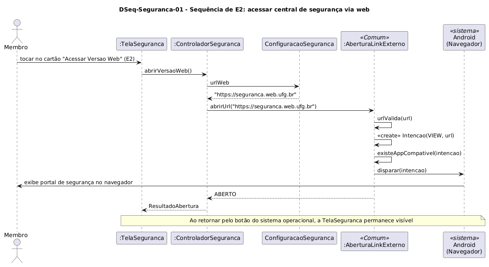

# DSeq-Seguranca-01 – Sequência de E2: acessar central de segurança via web

| Campo | Valor |
|---|---|
| **Código** | `DSeq-Seguranca-01` |
| **Título** | Sequência de E2: acessar central de segurança via web |
| **Autor(a)** | Maicon Brendo da Silva |
| **Revisor(a)** | Revisor(a) a definir |
| **Status** | Em produção |
| **Rastreia para** | `DCdu-Seguranca-01`, `DAtv-Seguranca-01`, `DIhc-Seguranca-01`, `DCla-Seguranca-01`, `DCla-Comum-01` |

## Diagrama

Fonte: [`DSeq-Seguranca-01.puml`](DSeq-Seguranca-01.puml)

## Descrição

O diagrama detalha a sequência de troca de mensagens correspondente à ação em que o usuário toca no cartão "Acessar Versao Web" (evento `E2` do `DIhc-Seguranca-01`) para abrir o portal web de segurança da universidade.

### Dinâmica das mensagens

1. O usuário aciona o cartão na camada de interface (`TelaSeguranca`).
2. A tela repassa a requisição ao `ControladorSeguranca.abrirVersaoWeb()`.
3. O controlador lê a constante `ConfiguracaoSeguranca.urlWeb` e invoca `ILinkExterno.abrirUrl("https://seguranca.web.ufg.br")`.
4. A implementação `AberturaLinkExterno` do pacote `Comum` valida a URL, cria o Intent de visualização (`ACTION_VIEW`) e dispara a abertura para o sistema Android.
5. O navegador padrão do aparelho é executado em primeiro plano apresentando a página da segurança da UFG.
6. A interface `TelaSeguranca` permanece preservada na pilha de navegação, sendo reexibida quando o usuário retorna ao Minha UFG.

## Referências

GOOGLE. **Antigravity**. Assistente de IA para Engenharia de Software. Disponível em: https://antigravity.google.com. Acesso em: 29 out. 2026.

INSTITUTE OF ELECTRICAL AND ELECTRONICS ENGINEERS. **Guide to the Software Engineering Body of Knowledge – SWEBOK v4**. Cap. 11 (Software Engineering Models and Methods). IEEE, 2024.

---

## Registro de revisão

| Data | Revisor(a) | Situação | Observações |
|---|---|---|---|
| | | | |

