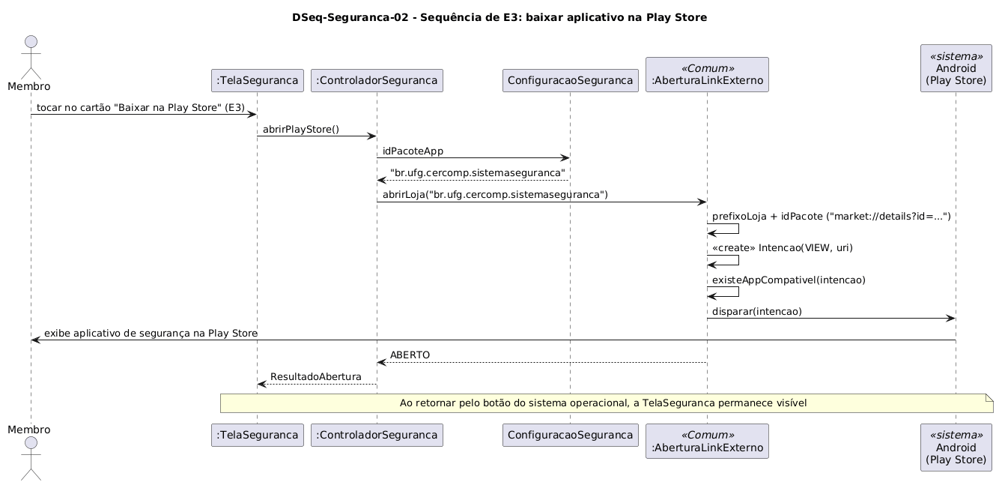

# DSeq-Seguranca-02 – Sequência de E3: baixar aplicativo na Play Store

| Campo | Valor |
|---|---|
| **Código** | `DSeq-Seguranca-02` |
| **Título** | Sequência de E3: baixar aplicativo na Play Store |
| **Autor(a)** | Maicon Brendo da Silva |
| **Revisor(a)** | Revisor(a) a definir |
| **Status** | Em produção |
| **Rastreia para** | `DCdu-Seguranca-01`, `DAtv-Seguranca-01`, `DIhc-Seguranca-01`, `DCla-Seguranca-01`, `DCla-Comum-01` |

## Diagrama

Fonte: [`DSeq-Seguranca-02.puml`](DSeq-Seguranca-02.puml)

## Descrição

O diagrama detalha a sequência de troca de mensagens correspondente à ação em que o usuário toca no cartão "Baixar na Play Store (Android)" (evento `E3` do `DIhc-Seguranca-01`) para acessar a página do aplicativo oficial de segurança da UFG.

### Dinâmica das mensagens

1. O usuário aciona o cartão correspondente na `TelaSeguranca`.
2. A tela invoca `ControladorSeguranca.abrirPlayStore()`.
3. O controlador lê a constante `ConfiguracaoSeguranca.idPacoteApp` (`"br.ufg.cercomp.sistemaseguranca"`) e invoca `ILinkExterno.abrirLoja(...)`.
4. A implementação `AberturaLinkExterno` do pacote `Comum` monta a URI `market://details?id=br.ufg.cercomp.sistemaseguranca`, valida a existência de aplicativo compatível no sistema Android e dispara o Intent.
5. A Google Play Store abre diretamente na página oficial de download/atualização do aplicativo de segurança.
6. A interface `TelaSeguranca` permanece preservada na pilha de navegação, sendo reexibida quando o usuário retorna ao Minha UFG.

## Referências

GOOGLE. **Antigravity**. Assistente de IA para Engenharia de Software. Disponível em: https://antigravity.google.com. Acesso em: 29 out. 2026.

INSTITUTE OF ELECTRICAL AND ELECTRONICS ENGINEERS. **Guide to the Software Engineering Body of Knowledge – SWEBOK v4**. Cap. 11 (Software Engineering Models and Methods). IEEE, 2024.

---

## Registro de revisão

| Data | Revisor(a) | Situação | Observações |
|---|---|---|---|
| | | | |

