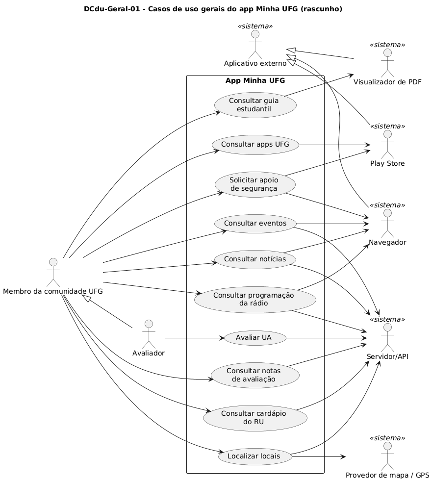
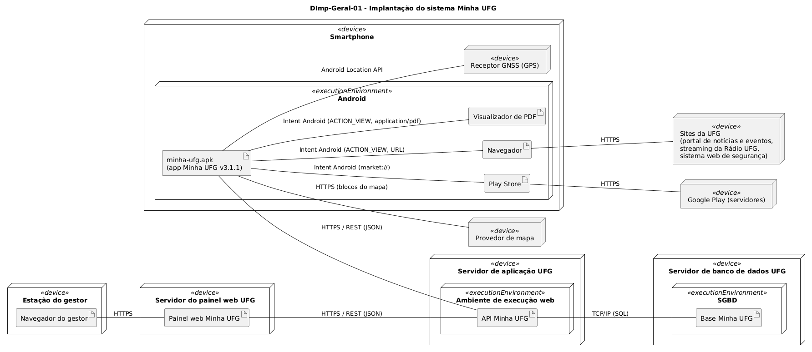
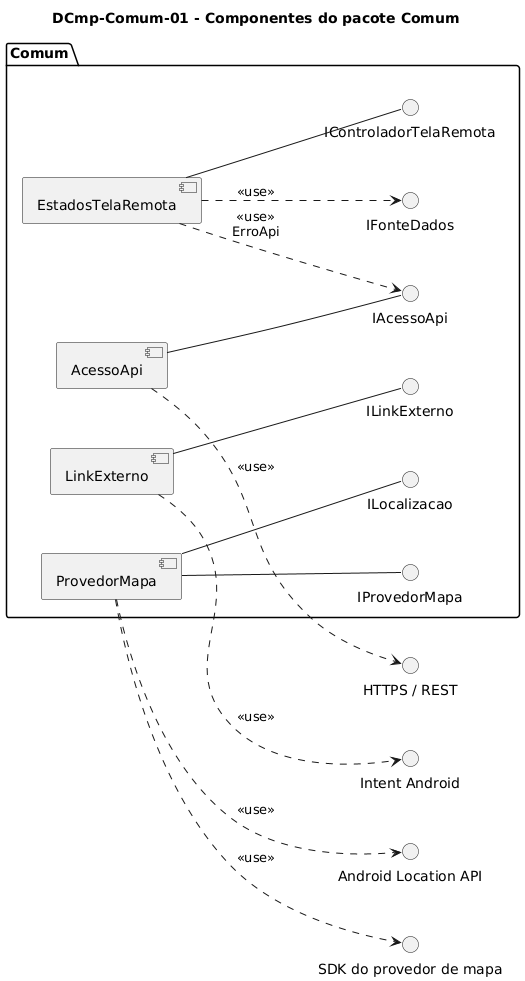
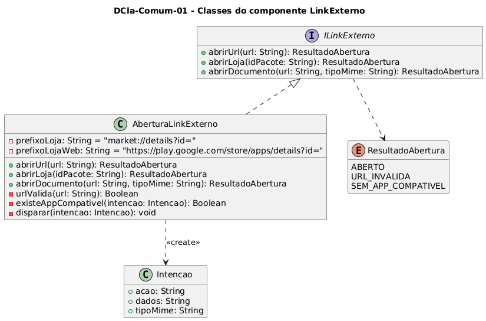
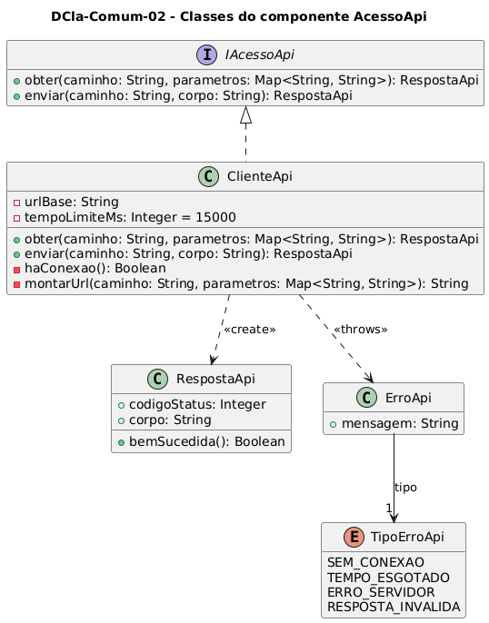
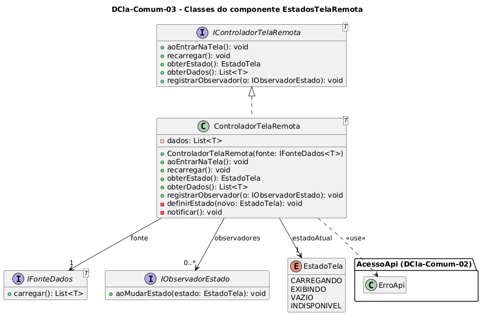
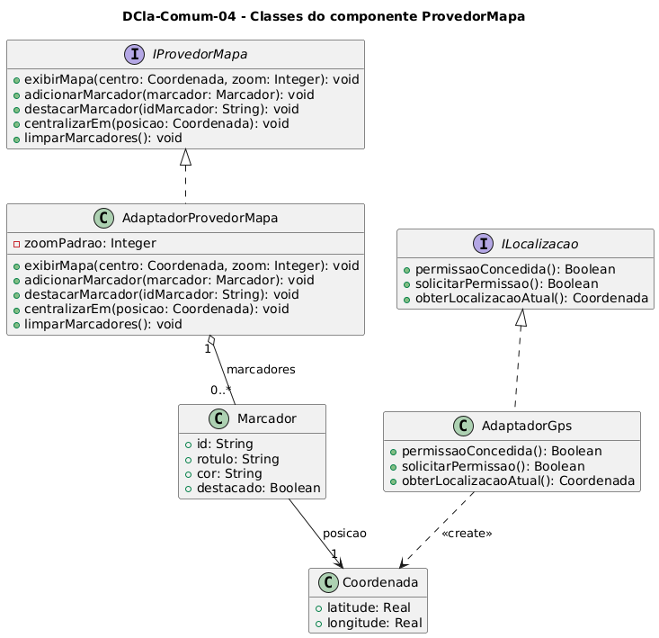
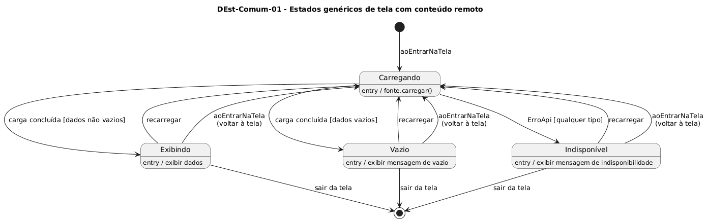

**Universidade Federal de Goiás – Instituto de Informática**  
Bacharelado em Engenharia de Software  
Disciplina: INF 0290 – Projeto de Software – semestre 2026/2  
Tarefa: Atividades Práticas Supervisionadas (APS) – Sistema de Informação Minha UFG  
Docente: Prof. Juliano Lopes de Oliveira

# Relatório de Evolução do Projeto nº 01

**Equipe Cinza** · Linha de base do projeto

| Campo | Valor |
|---|---|
| **Data do relatório** | 16 de outubro de 2026 |
| **Período coberto** | 7 a 16 de outubro de 2026 |
| **Estado do repositório** | Ramo `main`, commit `3b06a17` (pull request nº 4 integrado) |
| **Repositório** | github.com/joseduardogon/Minha_UFG_Grupo_Cinza |
| **Integrantes** (Apêndice C do enunciado, em ordem alfabética) | Daniel Noleto de Oliveira · José Eduardo Gontijo de Carvalho · Maicon Brendo da Silva · Phablo Tavares Paixão · Waldson Ferreira Barbosa Júnior |
| **Frentes de trabalho** | Pessoas A, B, C e D (a atribuição nominal será formalizada na editoração do documento final) |
| **Entrega final** | 4 de novembro de 2026, 23h59, via SIGAA (entrega interna do PDF em 2 de novembro) |

## Sumário

<!-- O sumário abaixo é substituído por um índice com páginas na geração do PDF. -->

1. Resumo executivo
2. Contexto e escopo do projeto
3. Organização da equipe e do processo
4. Cronograma e situação dos marcos
5. O que foi feito até 16/10/2026
6. Artefatos produzidos
7. Cobertura do Apêndice D e situação por frente
8. Decisões de projeto registradas
9. Riscos e pontos de atenção
10. Próximos passos
11. Pontos para orientação do docente
12. Como os próximos relatórios darão continuidade a este
13. Referências
14. Apêndice A – Histórico de commits do repositório

## 1. Resumo executivo

Este é o primeiro relatório de evolução da Equipe Cinza e funciona como **linha de base**: registra tudo o que foi definido e estruturado no projeto até 16 de outubro de 2026, no décimo dia de existência do repositório, e o que falta fazer até a entrega. Os relatórios seguintes registrarão apenas as mudanças e a evolução em relação a este (seção 12).

**Em uma frase:** a fase de organização está concluída e a fase de produção de modelos foi iniciada pelos artefatos transversais; as funcionalidades de cada pessoa ainda não têm modelos publicados no repositório.

**O que está concluído**

- Divisão do trabalho em quatro frentes (Pessoas A a D), com pesos calculados e revisão cruzada em duplas.
- Contrato-base com 12 seções: datas, ferramentas, convenções de nomes, atores, granularidade da cascata de diagramas, entidades compartilhadas e seus donos, regras da avaliação, arquitetura, revisão, mudanças e uso de IA.
- Repositório GitHub organizado em 17 pastas, com modelo de item de informação (`Template-Item.md`), regra de ramos e pull requests, e `CODEOWNERS`.

**O que está produzido**

- **9 itens de informação**, todos de autoria da Pessoa D e revisão da Pessoa C, cada um com fonte PlantUML e imagem: casos de uso gerais (rascunho), diagrama de pacotes, diagrama de implantação, diagrama de componentes do pacote Comum, quatro diagramas de classes do Comum e o diagrama de estados genérico de tela remota.

**O que ainda não existe**

- Nenhum item está no estado "Pronto" (revisado e no repositório, conforme a seção 10 do contrato): 8 estão em revisão e 1 é rascunho.
- Nenhuma funcionalidade tem a cascata completa (casos de uso, atividades, IHC, sequência, estados, contratos).
- O modelo conceitual de dados integrado, as atas dos checkpoints e as entregas de entidades de A, B e C ainda não foram registrados no repositório.

**Tabela 1 – Indicadores da linha de base (16/10/2026)**

| Indicador | Valor em 16/10/2026 |
|---|---|
| Itens de informação produzidos | 9 |
| Itens no estado "Pronto" | 0 |
| Itens em revisão / em rascunho | 8 / 1 |
| Pacotes com diagrama de componentes (de 12) | 1 (Comum) |
| Componentes com diagrama de classes | 4 (todos os do Comum) |
| Funcionalidades com a cascata completa (de 10) | 0 |
| Funcionalidades com ao menos um item publicado (de 10) | 0 (apenas estrutura de pastas) |
| Atas de checkpoint registradas | 0 |
| Commits / pull requests integrados | 18 / 4 |
| Dias até a entrega interna (2/11) / ao SIGAA (4/11) | 17 / 19 |

## 2. Contexto e escopo do projeto

### 2.1 O trabalho

A APS da disciplina INF 0290 consiste em analisar e projetar o aplicativo móvel do sistema de informação **Minha UFG** (enunciado, Apêndice A), aplicando o processo de projeto de software. O escopo cobre somente o aplicativo móvel; o painel web (painel de controle) fica fora do escopo e aparece apenas como sistema que alimenta o servidor. O trabalho tem duas frentes:

1. **Engenharia reversa** da versão atual do app (v3.1.1), que tem oito funcionalidades: Segurança, Rádio, Guia Estudantil, Eventos, Notícias, Restaurante Universitário (RU), Locais e Apps UFG. A modelagem parte de capturas de tela do app, sem acesso ao código-fonte.
2. **Evolução**: nova funcionalidade de **avaliação de qualidade das Unidades Acadêmicas (UA)**. Dimensões de qualidade agrupam elementos educacionais; o usuário dá notas de 0 a 5 a questões predefinidas sobre cada elemento; a média dos elementos forma a nota da dimensão e a média das dimensões forma a nota da avaliação. O app deve mostrar a nota por UA, a média por área de conhecimento (CNPq) e a nota da UFG como um todo.

### 2.2 O que o enunciado exige

O Apêndice D define os itens de informação mínimos. Os modelos são encadeados, e essa cadeia (a "cascata") orienta a ordem de produção da equipe.

**Tabela 2 – Itens de informação exigidos (Apêndice D) e siglas adotadas**

| Visão | Item | Sigla | Quantidade esperada |
|---|---|---|---|
| Estrutural | Diagrama de dados e dicionário de dados | DDados, DD | 1 de cada, integrados |
| Estrutural | Diagrama de implantação | DImp | 1 |
| Estrutural | Diagrama de pacotes | DPac | 1 |
| Estrutural | Diagrama de componentes | DCmp | 1 por pacote |
| Estrutural | Diagrama de classes | DCla | 1 por componente |
| Comportamental | Diagrama de casos de uso | DCdu | 1 geral, detalhado por funcionalidade |
| Comportamental | Diagrama de atividades | DAtv | 1 por caso de uso |
| Comportamental | Diagrama de sequência | DSeq | 1 por atividade |
| Comportamental | Protótipo de IHC | DIhc | 1 por tela |
| Comportamental | Diagrama de estados | DEst | 1 por DIhc |
| Comportamental | Contrato de operação e regras E-C-A | Contrato, ECA | 1 por operação de classe; regras quando houver |

Também são exigidos: documento único em PDF com o nome `INF0290-APS-Cinza`, cabeçalho com disciplina, tarefa e autores em ordem alfabética, identificação de autor e revisor em cada item (a mesma pessoa não pode ser autora e revisora do mesmo item), referências bibliográficas, registro de uso de IA com o prompt completo e apêndices de atas e comunicações da equipe.

## 3. Organização da equipe e do processo

### 3.1 Princípio da divisão

O Apêndice C do enunciado critica o "esquartejamento" do trabalho e o critério 4.2 avalia a consistência entre modelos. Por isso a equipe adotou o princípio de **dividir e conquistar**: cada pessoa produz sozinha a cascata completa de uma fatia de funcionalidades, e os artefatos que pertencem ao sistema inteiro (os "transversais") têm um dono que integra a contribuição de todos. Assim, ninguém desenha o seu próprio modelo de dados ou a sua própria arquitetura.

### 3.2 Fatias, pesos e revisão cruzada

Os pesos (Tabela 3) medem quanto cada parte gera de diagramas (telas, estados, dados e regras). O total é de cerca de 28 pontos, ou 7 por pessoa. Todas as telas do app atual recarregam ao entrar e não têm cache; esse comportamento comum é modelado uma única vez, nos transversais.

**Tabela 3 – Peso de cada parte do trabalho**

| Parte | Justificativa resumida | Peso |
|---|---|---|
| Segurança | Dois botões que abrem links externos; sem dados próprios | 1 |
| Guia Estudantil | Abre um PDF estático; o app não modela o conteúdo | 1 |
| Apps UFG | Lista fixa de 3 apps; tocar abre a loja | 1 |
| Notícias | Lista por regional; tocar abre link externo | 1 |
| Rádio | Grade semanal com abas por dia; o play abre site externo | 2 |
| RU | Cardápio com três refeições, categorias diferentes e seletor de dia | 2,5 |
| Eventos | Calendário, troca de mês, filtro por data, intervalos de datas e estado sem eventos | 3 |
| Locais | Lista, mapa com pinos por categoria, GPS e permissão de localização | 3,5 |
| Avaliação de UA: registrar | Funcionalidade nova: dimensões, elementos, questões, notas, validação e identificação do avaliador | 6 |
| Avaliação de UA: consultar notas | Nota por UA, por área CNPq e da UFG, com as regras de cálculo das médias | 3 |
| Transversais | Artefatos do sistema inteiro e integração do documento | 4 |

**Tabela 4 – Divisão por pessoa e revisão em duplas**

| Pessoa | Fatia | Peso | Revisor(a) |
|---|---|---|---|
| A | Avaliação: registrar (dona do modelo de dados da avaliação) e Segurança | 7 | B |
| B | Avaliação: consultar notas (dona das regras de cálculo), Locais e Apps UFG | 7,5 | A |
| C | Eventos, RU e Notícias | 6,5 | D |
| D | Transversais, Rádio e Guia Estudantil | 7 | C |

A Avaliação foi dividida em duas fatias com fronteira clara: A cuida de como uma avaliação nasce (dimensões, elementos, questões, registro e validação) e B cuida do que se calcula a partir dela (elementos, dimensão, avaliação, UA, área e UFG). B também fica com Locais, porque o Instituto de Informática aparece como local no mapa e como UA avaliada. As revisões são em duplas (Tabela 4: A com B, C com D); assim todos são autores e revisores sem revisar o próprio item. Nos itens atuais, autor e revisor aparecem pelos rótulos "Pessoa A" a "Pessoa D"; os nomes serão preenchidos na editoração do documento final.

### 3.3 Os transversais (frente da Pessoa D)

Transversal é o que atravessa todas as funcionalidades. A Pessoa D é dona dos seguintes itens e coordena a integração:

- modelo conceitual de dados (diagrama e dicionário), integrando as entidades entregues por A, B e C;
- diagrama de implantação e diagrama de pacotes;
- casos de uso gerais (os demais integrantes detalham os seus);
- componentes compartilhados: abertura de link externo, acesso à API, estados de tela remota e provedor de mapa;
- tela inicial (protótipo de IHC e diagrama de estados);
- editoração do documento final (cabeçalho, índice, legendas, referências, apêndices de prompts de IA e de atas).

### 3.4 Contrato-base

O arquivo `contrato-base.md` reúne as regras que todos seguem para trabalhar sem conflitos na integração. Os pontos principais estão na Tabela 5.

**Tabela 5 – Resumo do contrato-base**

| Seção | Conteúdo |
|---|---|
| 1. Equipe e fatias | Pessoas A a D, fatias e revisores (Tabela 4) |
| 2. Datas | Entrega no SIGAA em 04/11/2026, 23h59; entrega interna do PDF em 02/11/2026; checkpoint às quartas, 19h, 30 min, com ata |
| 3. Ferramentas | Todos os diagramas em PlantUML (inclusive protótipos de IHC em Salt), estilo padrão sem tema; tudo versionado no GitHub; comunicação por WhatsApp |
| 4. Convenções | Nome `<TIPO>-<Funcionalidade>-<nn>` (ex.: `DAtv-RU-01`); elementos em português, `camelCase` para atributos e operações e `PascalCase` para classes; referências em ABNT; template de item com código, título, autor, revisor, rastreia para, diagrama, descrição e referências |
| 5. Atores | Membro da comunidade UFG (anônimo), Avaliador (anônimo), Servidor/API, Aplicativo externo (generalização de Play Store, Navegador e Visualizador de PDF) e Provedor de mapa / GPS. O Painel web não interage com o app e aparece só no diagrama de implantação |
| 6. Granularidade | Atividade é cada ação do DAtv em que o usuário interage com o app ou o app interage com o servidor ou sistema externo; cada uma gera um DSeq. Passos internos triviais não geram DSeq |
| 7. Entidades compartilhadas | Regional e Campus (C); Local, Unidade Acadêmica e Área de conhecimento CNPq (B); Usuário e identificação do avaliador (A). Unidade Acadêmica é um Local. Quem precisa de entidade alheia a referencia, não a redefine |
| 8. Avaliação | O avaliador é anônimo (não há login); pode avaliar a mesma UA mais de uma vez; avaliação registrada não pode ser editada nem excluída |
| 9. Arquitetura | Um pacote por funcionalidade e um pacote Comum, com os quatro componentes compartilhados modelados uma única vez |
| 10. Revisão | O revisor devolve em até 1 dia; um item está pronto quando foi revisado e está no repositório |
| 11. Mudanças | Toda mudança no contrato passa pela Pessoa D |
| 12. Uso de IA | Uso livre; cada pessoa registra IA, URL, data e prompt, para o apêndice exigido pela regra 6 |

Ordem de produção dentro de cada fatia, para evitar refazer diagramas: casos de uso, atividades, IHC, entidades, componentes e classes, sequência, estados, contratos e regras E-C-A.

### 3.5 Repositório e fluxo de trabalho

O repositório tem uma pasta por funcionalidade ou frente, e cada item de informação (a estrutura está na Tabela 6) é um par de arquivos com o mesmo nome: um `.md`, preenchido a partir do `Template-Item.md`, e um `.puml` com a fonte do diagrama (a imagem `.png` é versionada junto). Nada entra direto na `main`: o trabalho segue em ramo próprio e entra por pull request, com `CODEOWNERS` definido. O registro de revisão ao fim de cada item guarda data, revisor, situação e observações.

**Tabela 6 – Estrutura do repositório**

| Pasta | Conteúdo | Dono | Revisor |
|---|---|---|---|
| `Geral/` | DCdu, DImp, DPac, DDados e DD do sistema inteiro | D | C |
| `Comum/` | Componentes compartilhados (link externo, API, estados de tela remota, mapa) | D | C |
| `Inicio/` | Tela inicial | D | C |
| `Radio/`, `Guia/` | Rádio; Guia Estudantil | D | C |
| `Seguranca/`, `AvalRegistrar/` | Segurança; Avaliação – registrar | A | B |
| `AvalConsultar/`, `Locais/`, `AppsUFG/` | Avaliação – consultar notas; Locais; Apps UFG | B | A |
| `Eventos/`, `RU/`, `Noticias/` | Eventos; Restaurante Universitário; Notícias | C | D |
| `Integracao/` | Recebimento de entidades e rastreabilidade (trabalho de D) | D | – |
| `Atas/` | Atas dos checkpoints e registro de comunicações | todos | – |
| `IA/` | Registro de uso de IA, um arquivo por pessoa | todos | – |
| `Docs/` | Documentos de apoio (enunciado, roteiro inicial, guia de diagramas) | – | – |

## 4. Cronograma e situação dos marcos

O contrato divide as quatro semanas até a entrega em marcos (Tabela 7). A situação se refere ao conteúdo do ramo `main` em 16/10/2026; trabalho em andamento nos ramos locais de cada pessoa não aparece aqui.

**Tabela 7 – Marcos do contrato e situação em 16/10/2026**

| Semana | Período | Marco | Situação |
|---|---|---|---|
| 1 | até 13/10 | Contrato publicado; entidades de todos entregues a D | Contrato publicado em 10/10. Entregas de entidades de A, B e C ainda não registradas no repositório |
| 2 | 14/10 a 20/10 | Cada pessoa com ao menos uma funcionalidade com cascata completa; D fecha implantação, pacotes e modelo de dados integrado | **Em andamento.** Implantação e pacotes feitos (em revisão); modelo de dados integrado pendente; nenhuma cascata completa publicada |
| 3 | 21/10 a 27/10 | Tudo produzido (incluindo contratos e regras E-C-A) e revisado | Não iniciada |
| 4 | 28/10 a 04/11 | Só correções e montagem do PDF; nenhum diagrama novo | Não iniciada |

Regra adicional: o modelo de dados da Avaliação (Pessoa A) era devido em 10/10; enquanto isso, a Pessoa B começa por Locais. Não há registro dessa entrega no repositório.

## 5. O que foi feito até 16/10/2026

O repositório foi criado em 7 de outubro de 2026. O histórico tem 18 commits e 4 pull requests integrados (Tabela 8; detalhes no Apêndice A).

**Tabela 8 – Linha do tempo**

| Data | Marco | Resultado |
|---|---|---|
| 07/10 | Início do projeto | Repositório criado; `CODEOWNERS`; roteiro inicial do projeto (`Docs/Explicacao_Roteiro.md`); guia didático dos diagramas UML (`Docs/Guia_Diagramas.md`); enunciado da APS versionado como documento de referência; documento de divisão de trabalho redigido |
| 10/10 | Contrato | `contrato-base.md` publicado |
| 11/10 | Pull request nº 1 | Contrato-base integrado à `main` |
| 14/10 | D-PRE-01 – preparação do repositório | Estrutura de pastas por funcionalidade, `Template-Item.md`, `README.md` com convenções, registro de IA da Pessoa D; documentos de apoio movidos para `Docs/` (pull request nº 3) |
| 14/10 | Ajuste do contrato | Seção 5: ator "Aplicativo externo" generalizado em três especializações; Painel web restrito ao diagrama de implantação |
| 14/10 | D-DST-01 | Casos de uso gerais (rascunho) |
| 14/10 | D-DST-02 | Diagrama de pacotes e diagrama de implantação |
| 14/10 | D-DST-03 | Diagrama de componentes, quatro diagramas de classes e diagrama de estados do pacote Comum (pull request nº 4, que integrou D-DST-01 a D-DST-03) |

Os códigos D-PRE, D-DST, D-IND e D-INT pertencem ao roteiro semanal da Pessoa D e designam, nesta ordem, a preparação do repositório, à entrega de base para destravar o trabalho da equipe, às entregas individuais e à integração das entregas de todos. As etapas D-PRE-01 e D-DST-01 a D-DST-03 estão concluídas e integradas à `main`.

## 6. Artefatos produzidos

### 6.1 Inventário

Todos os itens da Tabela 9 têm autoria da Pessoa D e revisão da Pessoa C. Na data deste relatório, os registros de revisão ao fim de cada item ainda estão em branco.

**Tabela 9 – Itens de informação produzidos**

| Código | Título | Status | Rastreia para |
|---|---|---|---|
| `DCdu-Geral-01` | Casos de uso gerais do app Minha UFG | Em produção (rascunho) | Os 10 `DCdu-<Funcionalidade>-01`, `DImp-Geral-01`, `DPac-Geral-01` |
| `DPac-Geral-01` | Pacotes do app Minha UFG | Em revisão | `DCdu-Geral-01`, `DImp-Geral-01`, os `DCmp` de todos os pacotes, `DIhc-Inicio-01` |
| `DImp-Geral-01` | Implantação do sistema Minha UFG | Em revisão | `DCdu-Geral-01`, `DPac-Geral-01`, `DCmp-Comum-01`, `DCla-Comum-01`, `-02` e `-04` |
| `DCmp-Comum-01` | Componentes do pacote Comum | Em revisão | `DPac-Geral-01`, `DImp-Geral-01`, `DCla-Comum-01` a `-04`, `DEst-Comum-01` |
| `DCla-Comum-01` | Classes do componente LinkExterno | Em revisão | `DCmp-Comum-01`, `DImp-Geral-01`, `DCdu-Geral-01` |
| `DCla-Comum-02` | Classes do componente AcessoApi | Em revisão | `DCmp-Comum-01`, `DImp-Geral-01`, `DCla-Comum-03` |
| `DCla-Comum-03` | Classes do componente EstadosTelaRemota | Em revisão | `DCmp-Comum-01`, `DCla-Comum-02`, `DEst-Comum-01` |
| `DCla-Comum-04` | Classes do componente ProvedorMapa | Em revisão | `DCmp-Comum-01`, `DImp-Geral-01`, `DCdu-Geral-01` |
| `DEst-Comum-01` | Estados genéricos de tela com conteúdo remoto | Em revisão | `DCla-Comum-03`, `DCmp-Comum-01` |

A coluna "Rastreia para" atende ao critério 5 (rastreabilidade): cada item aponta para os itens de que depende ou que o detalham. A matriz completa de rastreabilidade entre todos os itens será montada na integração (`Integracao/rastreabilidade.md`, etapa D-INT-04).

### 6.2 Casos de uso gerais (DCdu-Geral-01)

O diagrama (Figura 1) tem um caso de uso macro por funcionalidade: as oito da versão atual e as duas da evolução (Avaliar UA e Consultar notas de avaliação). Cada macro será detalhado pelo dono da funcionalidade em seu próprio `DCdu-<Funcionalidade>-01`, com quantos casos de uso forem necessários.

*Figura 1 – Casos de uso gerais do app Minha UFG (rascunho). Fonte: `Geral/DCdu-Geral-01.puml`.*

**Atores.** O Membro da comunidade UFG usa o app de forma anônima. O Avaliador é uma especialização do Membro, também anônimo. Os atores secundários são sistemas com que o app interage (Tabela 10).

**Tabela 10 – Atores secundários e casos de uso em que atuam**

| Ator | Papel | Casos de uso |
|---|---|---|
| Servidor/API | Fornece o conteúdo remoto e registra avaliações | Rádio, Eventos, Notícias, RU, Locais, Avaliar UA, Consultar notas |
| Provedor de mapa / GPS | Exibe o mapa do campus e a localização atual | Localizar locais |
| Aplicativo externo (Navegador) | Abre páginas fora do app | Segurança (versão web), Rádio (player), Eventos, Notícias |
| Aplicativo externo (Play Store) | Abre a página de um app na loja | Segurança, Apps UFG |
| Aplicativo externo (Visualizador de PDF) | Abre o `guiaestudantil.pdf` pelo seletor de apps do Android | Guia estudantil |

Decisões de modelagem: a tela inicial é navegação e não objetivo do usuário, por isso não é caso de uso (é modelada em protótipo de IHC e diagrama de estados próprios); o Painel web não interage com o app, então não aparece nos DCdu; Apps UFG não acessa o servidor, pois a lista é fixa (três apps).

### 6.3 Diagrama de pacotes (DPac-Geral-01)

O app é organizado em 12 pacotes: um por funcionalidade (10), o pacote `Inicio` e o pacote `Comum` (Figura 2).

*Figura 2 – Pacotes do app Minha UFG e suas dependências. Fonte: `Geral/DPac-Geral-01.puml`.*

Dependências e decisões de arquitetura:

1. `Inicio` depende de todos os pacotes de funcionalidade, pois cada cartão do menu abre a tela inicial de uma funcionalidade.
2. Todo pacote de funcionalidade depende de `Comum`, pois usa ao menos um de seus componentes.
3. `Comum` não depende de nenhum outro pacote, o que o mantém reutilizável e estável.
4. A tela inicial fica em um pacote próprio, e não em `Comum`: juntá-los criaria dependência circular entre `Comum` e cada funcionalidade.
5. As funcionalidades da versão atual são independentes entre si. Só a evolução cria dependências: `AvalRegistrar` depende de `Locais` (a avaliação é feita sobre uma Unidade Acadêmica) e `AvalConsultar` depende de `Locais` e de `AvalRegistrar` (cujas notas agrega).
6. Pendência para a integração: onde ficam as entidades Regional e Campus (dono: Pessoa C), usadas por `Eventos`, `Noticias` e `Locais`.

### 6.4 Diagrama de implantação (DImp-Geral-01)

O diagrama (Figura 3) mostra os nós físicos e ambientes de execução e os protocolos entre eles (Tabela 11). O escopo do trabalho é o app, mas o painel web e os sistemas externos aparecem porque o app depende deles em execução.

*Figura 3 – Implantação do sistema Minha UFG. Fonte: `Geral/DImp-Geral-01.puml`.*

**Tabela 11 – Comunicação entre os nós**

| Origem para destino | Protocolo | Uso |
|---|---|---|
| App para API Minha UFG | HTTPS / REST (JSON) | Todo o conteúdo remoto e o registro de avaliações |
| App para provedor de mapa | HTTPS | Blocos do mapa do campus |
| App para receptor GNSS | Android Location API | Localização atual |
| App para Navegador, Play Store e Visualizador de PDF | Intent Android | Redirecionamentos para fora do app |
| Painel web para API | HTTPS / REST (JSON) | Cadastro de conteúdo |
| API para base de dados | TCP/IP (SQL) | Persistência |
| Navegador do gestor para Painel web | HTTPS | Uso do painel |

**Premissas da engenharia reversa**, explícitas no item: a tecnologia do servidor, do SGBD e do provedor de mapa não é visível no app, então os nós são nomeados pelo papel e não pelo produto; supõe-se que o painel web grava por meio da mesma API e não diretamente na base; supõe-se que o `guiaestudantil.pdf` é obtido por HTTPS e entregue ao Visualizador de PDF por Intent.

### 6.5 Pacote Comum: componentes, classes e estados

O pacote `Comum` reúne os quatro componentes compartilhados do contrato. Eles são modelados uma vez e só referenciados pelos demais pacotes, por meio de interfaces (Figura 4 e Tabela 12).

*Figura 4 – Componentes do pacote Comum. Fonte: `Comum/DCmp-Comum-01.puml`.*

**Tabela 12 – Componentes do pacote Comum**

| Componente | Interface oferecida | Usado por | Classes |
|---|---|---|---|
| LinkExterno | `ILinkExterno` | Segurança, Rádio, Guia, Eventos, Notícias, Apps UFG | `DCla-Comum-01` |
| AcessoApi | `IAcessoApi` | Todas as funcionalidades com conteúdo remoto | `DCla-Comum-02` |
| EstadosTelaRemota | `IControladorTelaRemota` | Todas as telas com conteúdo remoto | `DCla-Comum-03` |
| ProvedorMapa | `IProvedorMapa`, `ILocalizacao` | Locais | `DCla-Comum-04` |

A interface `IFonteDados`, definida em `Comum`, é implementada por cada funcionalidade; o controlador de estados a usa para pedir a carga dos dados sem conhecer a funcionalidade. Uma tela com conteúdo remoto cria um `ControladorTelaRemota` com a sua implementação de `IFonteDados`, que chama `IAcessoApi.obter(...)` e converte o JSON nas entidades da funcionalidade.

**LinkExterno** (`DCla-Comum-01`, Figura 5). Abre conteúdo fora do app e corresponde ao ator Aplicativo externo. Tem uma operação por especialização do ator: `abrirUrl` (Navegador), `abrirLoja` (Play Store, que tenta primeiro o esquema `market://` e depois o endereço web da loja) e `abrirDocumento` (Visualizador de PDF). `ResultadoAbertura` (`ABERTO`, `URL_INVALIDA`, `SEM_APP_COMPATIVEL`) existe para que o comportamento de falha possa ser especificado nos contratos, embora o app atual não exiba mensagem em caso de falha.

*Figura 5 – Classes do componente LinkExterno. Fonte: `Comum/DCla-Comum-01.puml`.*

**AcessoApi** (`DCla-Comum-02`, Figura 6). Centraliza a comunicação com a API (HTTPS/REST, JSON). `obter` faz consultas (GET); `enviar` faz envios (POST) e existe para o registro de avaliação, pois a versão atual não envia dados. Falhas são sinalizadas por `ErroApi` com um `TipoErroApi`: `SEM_CONEXAO`, `TEMPO_ESGOTADO`, `ERRO_SERVIDOR` ou `RESPOSTA_INVALIDA`. Não há cache: cada chamada vai ao servidor. O tempo limite de 15 s é premissa de projeto, não dado observado no app.

*Figura 6 – Classes do componente AcessoApi. Fonte: `Comum/DCla-Comum-02.puml`.*

**EstadosTelaRemota** (`DCla-Comum-03`, Figura 7). Padroniza o comportamento de toda tela com conteúdo remoto. `ControladorTelaRemota<T>` recebe uma `IFonteDados<T>`, chama `carregar()` e define o estado: lista com itens leva a `EXIBINDO`, lista vazia a `VAZIO` e qualquer `ErroApi` a `INDISPONIVEL`. `aoEntrarNaTela()` dispara nova carga sempre que a tela é exibida (inclusive ao voltar de outra tela), e `recarregar()` é chamado quando um filtro muda (data em Eventos, dia no RU, aba na Rádio). A tela é notificada por `IObservadorEstado`.

*Figura 7 – Classes do componente EstadosTelaRemota. Fonte: `Comum/DCla-Comum-03.puml`.*

**ProvedorMapa** (`DCla-Comum-04`, Figura 8). Isola o app do serviço de mapa e do GPS. É genérico: não conhece Local nem categoria, que pertencem ao pacote `Locais`. `IProvedorMapa` exibe o mapa, adiciona e destaca marcadores e recentraliza; `ILocalizacao` trata a permissão de localização e a posição atual. Adaptadores traduzem o SDK do provedor e a Android Location API para essas interfaces, de modo que trocar o provedor não afeta `Locais`.

*Figura 8 – Classes do componente ProvedorMapa. Fonte: `Comum/DCla-Comum-04.puml`.*

**Estados de tela remota** (`DEst-Comum-01`, Figura 9). O diagrama de estados do `ControladorTelaRemota` tem quatro estados (Carregando, Exibindo, Vazio, Indisponível) e três eventos de entrada (`aoEntrarNaTela`, `recarregar` e `ErroApi`). Os diagramas de estados de cada funcionalidade referenciarão este, em vez de repetir esses estados. A versão atual não tem botão de "tentar novamente": de Indisponível o usuário só sai trocando o filtro ou saindo e voltando à tela.

*Figura 9 – Estados genéricos de tela com conteúdo remoto. Fonte: `Comum/DEst-Comum-01.puml`.*

## 7. Cobertura do Apêndice D e situação por frente

A Tabela 13 compara o que o Apêndice D exige com o que já foi produzido, e a Tabela 14 mostra a situação de cada frente.

**Tabela 13 – Cobertura dos itens exigidos (Apêndice D)**

| Item | Esperado | Produzido | Situação |
|---|---|---|---|
| Diagrama de dados (DDados) | 1, integrado | 0 | A fazer; depende das entidades de A, B e C |
| Dicionário de dados (DD) | 1, integrado | 0 | A fazer; mesma dependência |
| Diagrama de implantação (DImp) | 1 | 1 | Em revisão |
| Diagrama de pacotes (DPac) | 1 | 1 | Em revisão |
| Diagrama de componentes (DCmp) | 12 (1 por pacote) | 1 (Comum) | 11 a fazer |
| Diagrama de classes (DCla) | 1 por componente | 4 (todos do Comum) | Comum completo; demais pacotes a fazer |
| Casos de uso (DCdu) | 1 geral e 10 detalhamentos | 1 geral (rascunho) | 10 detalhamentos a fazer |
| Atividades (DAtv) | 1 por caso de uso | 0 | A fazer |
| Sequência (DSeq) | 1 por atividade | 0 | A fazer |
| Protótipo de IHC (DIhc) | 1 por tela | 0 | A fazer |
| Estados (DEst) | 1 por DIhc | 1 (genérico do Comum) | Demais a fazer |
| Contratos de operação | 1 por operação de classe | 0 | A fazer |
| Regras E-C-A | Quando houver | 0 | A fazer |

**Tabela 14 – Situação por frente e pacote em 16/10/2026**

| Frente / pacote | Responsável | Revisor(a) | Situação |
|---|---|---|---|
| `Geral/` | D | C | 3 itens (DCdu rascunho, DPac, DImp); falta DDados e DD integrados |
| `Comum/` | D | C | 6 itens (DCmp, 4 DCla, DEst); pacote modelado |
| `Inicio/` | D | C | Pasta criada; sem itens |
| `Radio/`, `Guia/` | D | C | Pasta criada; sem itens |
| `Seguranca/`, `AvalRegistrar/` | A | B | Pasta criada; sem itens |
| `AvalConsultar/`, `Locais/`, `AppsUFG/` | B | A | Pasta criada; sem itens |
| `Eventos/`, `RU/`, `Noticias/` | C | D | Pasta criada; sem itens |
| `Integracao/` | D | – | Sem entregas de entidades; sem lista de recebimento |
| `Atas/` | todos | – | Sem atas nem registro de comunicações |
| `IA/` | todos | – | Registro da Pessoa D; faltam os de A, B e C |

## 8. Decisões de projeto registradas

As decisões da Tabela 15 estão registradas nos itens e no contrato; o documento final deve mantê-las consistentes.

**Tabela 15 – Decisões de projeto**

| Nº | Decisão | Motivo | Onde está registrada |
|---|---|---|---|
| 1 | Cada pessoa produz a cascata completa de uma fatia; os transversais têm um dono | Evitar o esquartejamento e garantir consistência (critério 4.2) | Divisão de trabalho; contrato, seção 1 |
| 2 | O avaliador é anônimo, sem login; pode avaliar a mesma UA mais de uma vez; avaliação registrada não é editada nem excluída | O app atual não tem login; simplifica o modelo e preserva o histórico | Contrato, seção 8 |
| 3 | "Aplicativo externo" é um ator abstrato com três especializações (Play Store, Navegador, Visualizador de PDF) | Todo redirecionamento para fora do app corresponde a um só componente, o LinkExterno | Contrato, seção 5; `DCdu-Geral-01` |
| 4 | O Painel web aparece só no diagrama de implantação | Ele alimenta o servidor e não interage com o app | Contrato, seção 5; `DImp-Geral-01` |
| 5 | Um DSeq por ação do DAtv com interação usuário–app ou app–servidor/sistema externo; passos triviais não geram DSeq | Controlar o volume da cascata | Contrato, seção 6 |
| 6 | Unidade Acadêmica é um Local; nem todo Local é UA | O Instituto de Informática é local no mapa e UA avaliada | Contrato, seção 7 |
| 7 | Pacote `Inicio` separado de `Comum` | Evitar dependência circular | `DPac-Geral-01` |
| 8 | `Comum` não depende de nenhum outro pacote | Estabilidade e reuso | `DPac-Geral-01` |
| 9 | Nenhuma tela guarda cache: todas recarregam ao entrar | Comportamento observado no app atual | `DCla-Comum-02`, `DCla-Comum-03`, `DEst-Comum-01` |
| 10 | Estados "vazio" e "indisponível" são distintos no modelo | São situações diferentes, e cada funcionalidade decide como apresentá-las | `DCla-Comum-03` |
| 11 | O resultado de abertura de link externo é modelado (`ResultadoAbertura`), embora o app atual não mostre mensagem de falha | Permitir especificar o comportamento nos contratos | `DCla-Comum-01` |
| 12 | Nós de implantação nomeados pelo papel, não pelo produto | A tecnologia do servidor não é observável no app | `DImp-Geral-01` |
| 13 | Prevalece o contrato quando houver divergência com os documentos de apoio iniciais | O contrato foi acordado com os participantes | Registro de IA da Pessoa D |

## 9. Riscos e pontos de atenção

A Tabela 16 lista os riscos e pontos de atenção identificados e a ação prevista para cada um.

**Tabela 16 – Riscos e pontos de atenção em 16/10/2026**

| Nº | Ponto | Impacto | Ação prevista |
|---|---|---|---|
| 1 | Nenhum item de A, B e C no repositório e entidades compartilhadas não entregues, com o marco da semana 1 já vencido | Bloqueia o modelo de dados integrado (D) e a consistência entre modelos; encurta o prazo das cascatas | Cobrar as entregas no próximo checkpoint; D registra o recebimento em `Integracao/recebimento.md` |
| 2 | Nenhum item "Pronto": registros de revisão em branco, com prazo de revisão de 1 dia no contrato | Itens de D sem validação por C; risco de retrabalho tardio | Revisão de C nos 9 itens, registrada em cada item |
| 3 | Atas dos checkpoints e registro de comunicações inexistentes | As atas contam na avaliação individual (Apêndice B do enunciado) e viram apêndice | Registrar a ata de 14/10 e as seguintes; criar `Atas/comunicacoes.md` |
| 4 | Entidades Regional e Campus: pacote de destino indefinido | Dependências entre pacotes podem mudar o `DPac-Geral-01` | Decidir na integração (D-INT-03), com a Pessoa C |
| 5 | A premissa "sem cache" é citada em item como "contexto da equipe, seção 1", documento que não está versionado | Rastreabilidade da fonte da premissa | Trocar a citação pelo documento de divisão de trabalho, que contém a premissa, ou versionar o contexto |
| 6 | Documentos de apoio iniciais (`Docs/Explicacao_Roteiro.md`, `Docs/Guia_Diagramas.md`) divergem do contrato (data de entrega em 03/11 e nomes genéricos de pacotes, por exemplo) | Risco de seguir orientações superadas | Contrato prevalece; revisar ou remover o guia de diagramas, como combinado |
| 7 | Engenharia reversa sem acesso ao código-fonte | Premissas (ex.: tempo limite de 15 s da API, painel gravando pela API) podem não corresponder à realidade | Manter as premissas explícitas nos itens e validar com o docente (seção 11) |
| 8 | Calendário apertado: 17 dias até a entrega interna, com semana 4 reservada a correções | Pouco tempo para produzir toda a cascata das 10 funcionalidades | Priorizar por peso e por dependência (seção 10) |

## 10. Próximos passos

### 10.1 Até 20/10/2026 (fim da semana 2)

1. **Pessoas A, B e C:** entregar a D as entidades compartilhadas no formato do contrato (entrada do dicionário de dados e trecho PlantUML): modelo de dados da Avaliação (dimensões, elementos e questões) e Usuário/identificação do avaliador (A); Local, Unidade Acadêmica e Área CNPq (B); Regional e Campus (C).
2. **Pessoas A, B e C:** concluir ao menos uma funcionalidade com a cascata completa (casos de uso, atividades, IHC, entidades, componentes e classes, sequência, estados), conforme o marco da semana 2.
3. **Pessoa D:** receber e validar as entidades (D-INT-01); montar o modelo conceitual de dados integrado, com diagrama e dicionário; iniciar a tela inicial (`DIhc-Inicio-01`, `DEst-Inicio-01`) e a cascata de Rádio e Guia Estudantil.
4. **Pessoa C:** revisar os 9 itens de D; **Pessoa D:** revisar os itens de C; registrar cada revisão no próprio item.
5. **Todos:** registrar a ata do checkpoint de 14/10 e do checkpoint de 21/10 (quarta, 19h); criar o registro de comunicações.

### 10.2 Semana 3 (21/10 a 27/10)

1. Terminar todos os itens, incluindo os contratos de operação e as regras E-C-A de cada classe.
2. Fechar o `DCdu-Geral-01` com os casos de uso detalhados de todos (D-INT-03) e atualizar o `DPac-Geral-01` com as dependências reveladas pelos diagramas de componentes de A, B e C.
3. Concluir a revisão em duplas (A e B; C e D) e corrigir os apontamentos.
4. Montar a matriz de rastreabilidade de todos os itens (D-INT-04) e verificar a consistência entre modelos: operações usadas nos diagramas de sequência declaradas nos diagramas de classes; entidades referenciadas, não redefinidas.

### 10.3 Semana 4 (28/10 a 04/11)

1. Nenhum diagrama novo; apenas correções.
2. Editoração do documento único `INF0290-APS-Cinza.pdf`: cabeçalho com autores em ordem alfabética, índice, numeração de seções, legendas e referências a figuras e tabelas, referências em ABNT, apêndice de prompts de IA e apêndice de atas e comunicações.
3. Leitura final conjunta; entrega interna do PDF em 02/11; envio no SIGAA até 04/11, 23h59.

### 10.4 Sugestão de priorização (a confirmar no próximo checkpoint)

Para reduzir o risco de prazo, propõe-se que cada pessoa conclua primeiro a cascata de uma funcionalidade de maior peso ou que sustente outras. O plano de trabalho já prevê que a Pessoa B comece por Locais enquanto o modelo de dados da Avaliação não é entregue.

- **A:** Avaliação – registrar (maior peso do trabalho, 6 pontos; seu modelo de dados é base de `AvalConsultar`);
- **B:** Locais (sustenta a Avaliação, pois UA é um Local) e, em seguida, Avaliação – consultar notas;
- **C:** Eventos, que define o padrão "lista do servidor filtrada por regional e data", comum a Notícias e RU;
- **D:** tela inicial e Rádio.

## 11. Pontos para orientação do docente

Os itens abaixo são dúvidas de definição do trabalho para as quais a equipe pede orientação do Prof. Juliano.

1. **Granularidade da cascata.** A equipe definiu que cada ação do diagrama de atividades em que o usuário interage com o app, ou o app interage com o servidor ou sistema externo, gera um diagrama de sequência; passos internos triviais não geram. Essa granularidade é adequada às expectativas da disciplina?
2. **Casos de uso.** O diagrama geral tem um caso de uso macro por funcionalidade, detalhado por cada responsável com quantos casos de uso forem necessários. Essa estratégia de detalhamento é aceitável?
3. **Engenharia reversa.** Como o app é modelado a partir de capturas de tela, sem acesso ao código-fonte, alguns elementos são premissas de projeto (por exemplo, o tempo limite de 15 s da API e o fato de o painel web gravar pela mesma API). A equipe os mantém explícitos nos itens. Esse tratamento é suficiente?

## 12. Como os próximos relatórios darão continuidade a este

Este relatório é a versão 1 e serve de ponto de partida. Cada relatório seguinte manterá o mesmo formato e registrará **apenas o que mudou** desde o anterior, com estas seções:

1. **Resumo da evolução:** o que mudou no período, com a Tabela 1 atualizada e a variação em relação ao relatório anterior.
2. **Itens novos e alterados:** inventário (como a Tabela 9) apenas dos itens criados, alterados ou revisados no período, com o motivo de cada alteração.
3. **Revisões concluídas:** itens que passaram a "Pronto", com data e revisor.
4. **Marcos e cronograma:** a Tabela 7 atualizada.
5. **Decisões e mudanças de contrato:** novas linhas da Tabela 15 e alterações no contrato-base.
6. **Riscos:** a Tabela 16 atualizada, indicando os riscos resolvidos, novos e persistentes.
7. **Próximos passos** do período seguinte.

**Tabela 17 – Valores de referência para comparação nos próximos relatórios**

| Referência | Valor em 16/10/2026 |
|---|---|
| Itens produzidos / prontos | 9 / 0 |
| Pacotes com DCmp | 1 de 12 |
| Funcionalidades com cascata completa | 0 de 10 |
| Atas registradas | 0 |
| Commit de referência | `3b06a17` (ramo `main`) |

## 13. Referências

INSTITUTE OF ELECTRICAL AND ELECTRONICS ENGINEERS. **Guide to the Software Engineering Body of Knowledge – SWEBOK v4**. Cap. 3 (Software Design) e cap. 11 (Software Engineering Models and Methods). IEEE, 2024.

INTERNATIONAL ORGANIZATION FOR STANDARDIZATION; INTERNATIONAL ELECTROTECHNICAL COMMISSION; INSTITUTE OF ELECTRICAL AND ELECTRONICS ENGINEERS. **ISO/IEC/IEEE 12207:2026**: Systems and software engineering – Software life cycle processes. Cláusula 6.4.5 (Design Definition Process). 2026.

UNIVERSIDADE FEDERAL DE GOIÁS. Instituto de Informática. **Definição de Atividades Práticas Supervisionadas (APS) da Disciplina**: INF 0290 – Projeto de Software, semestre 2026/2. Goiânia, 2026. Apêndices A a D.

EQUIPE CINZA. **Contrato Base – Equipe Cinza (APS INF0290)**. Repositório da equipe, arquivo `contrato-base.md`, 2026.

EQUIPE CINZA. **APS INF0290 – Divisão de Trabalho da Equipe Cinza**. Repositório da equipe, 7 out. 2026.

## 14. Apêndice A – Histórico de commits do repositório

**Tabela 18 – Commits do ramo `main` em 16/10/2026 (do mais antigo ao mais recente)**

| Data | Commit | Autor (Git) | Descrição |
|---|---|---|---|
| 07/10 | `92b8bf6` | José Eduardo Gontijo de Carvalho | Commit inicial |
| 07/10 | `c02fead` | José Eduardo Gontijo de Carvalho | Arquivo `CODEOWNERS` |
| 07/10 | `03990ba` | José Eduardo Gontijo de Carvalho | Documento de planejamento do projeto (roteiro inicial) |
| 07/10 | `88d0de6` | José Eduardo Gontijo de Carvalho | Guia didático completo dos diagramas UML |
| 07/10 | `25be587` | José Eduardo Gontijo de Carvalho | Enunciado da APS como documento de referência |
| 10/10 | `1d268b4` | Phablo Tavares Paixão | Upload do `contrato-base.md` |
| 11/10 | `06c7560` | José Eduardo Gontijo de Carvalho | Merge do pull request nº 1 (contrato-base) |
| 14/10 | `5cff517` | Phablo Tavares Paixão | Documento de divisão de trabalho da Equipe Cinza |
| 14/10 | `5b0c871` | phablo | D-PRE-01: estrutura de pastas, `Template-Item.md` e registro de IA de D |
| 14/10 | `7a38d68` | phablo | D-PRE-01: documentos de apoio movidos para `Docs/` |
| 14/10 | `9667230` | José Eduardo Gontijo de Carvalho | Merge do pull request nº 3 (estrutura do repositório) |
| 14/10 | `68c2a46` | José Eduardo Gontijo de Carvalho | Merge do pull request nº 2 (documento de divisão de trabalho) |
| 14/10 | `13e61fa` | phablo | Contrato, seção 5: Aplicativo externo generalizado; Painel web só no DImp |
| 14/10 | `798452f` | phablo | D-DST-01: `DCdu-Geral-01` (rascunho) e registro de IA atualizado |
| 14/10 | `4bbcd4a` | phablo | D-DST-02: `DPac-Geral-01` e `DImp-Geral-01` |
| 14/10 | `0bc74c3` | phablo | D-DST-03: `DCmp-Comum-01`, `DCla-Comum-01` a `-04` e `DEst-Comum-01` |
| 14/10 | `6a1381f` | José Eduardo Gontijo de Carvalho | Inclusão de Phablo Tavares Paixão como proprietário de código |
| 14/10 | `3b06a17` | José Eduardo Gontijo de Carvalho | Merge do pull request nº 4 (D-DST-01 a D-DST-03) |
